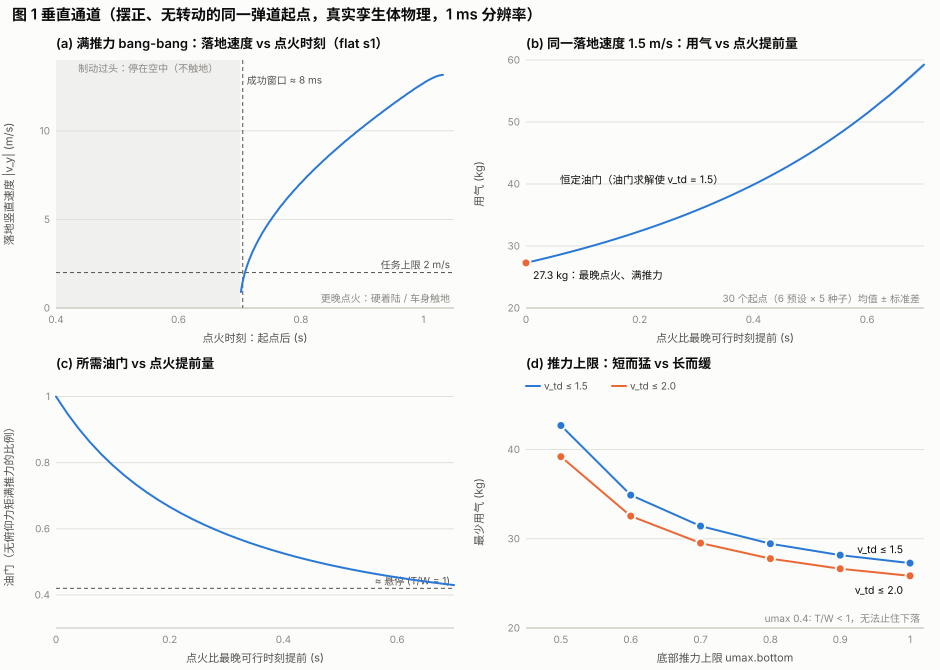
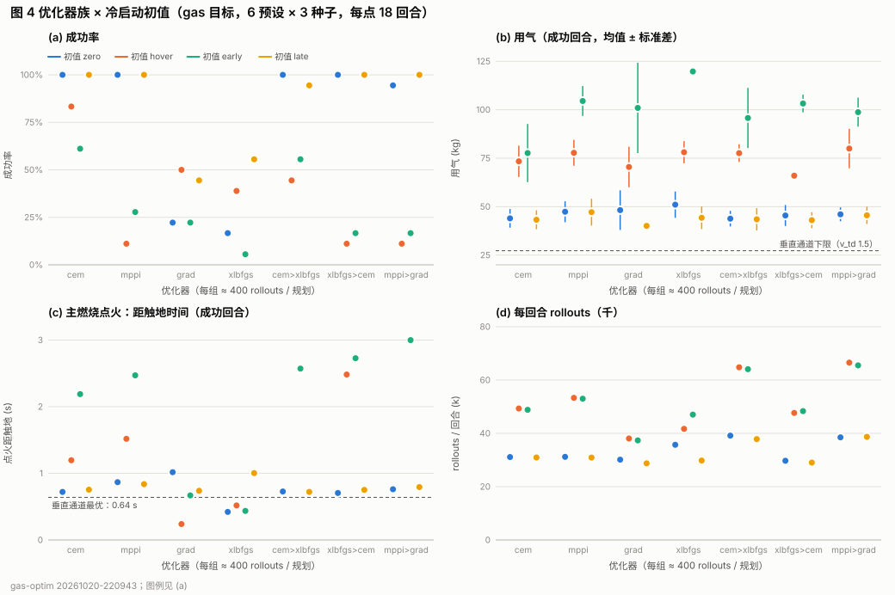
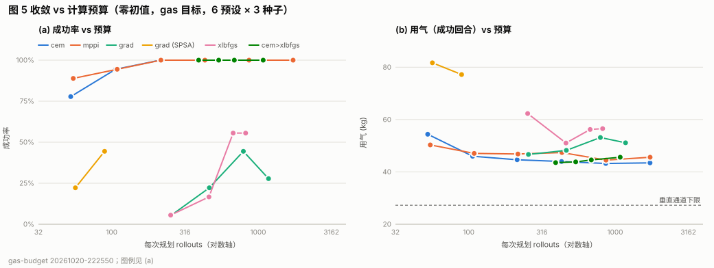
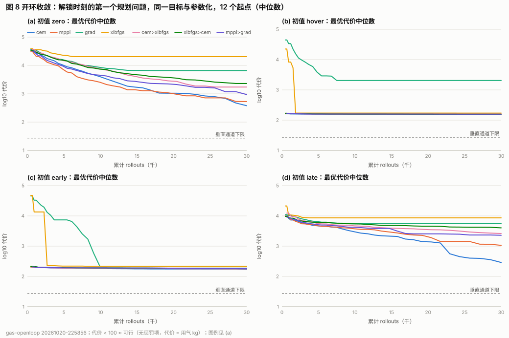
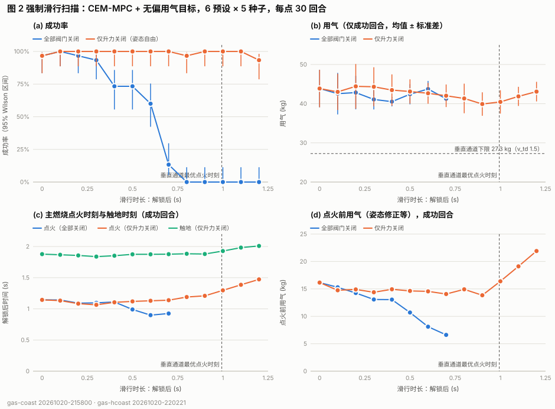
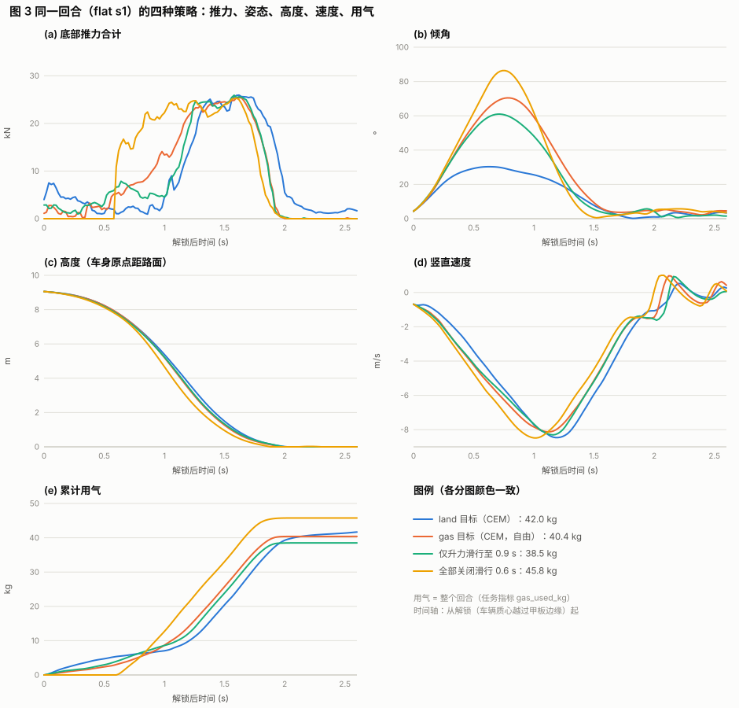
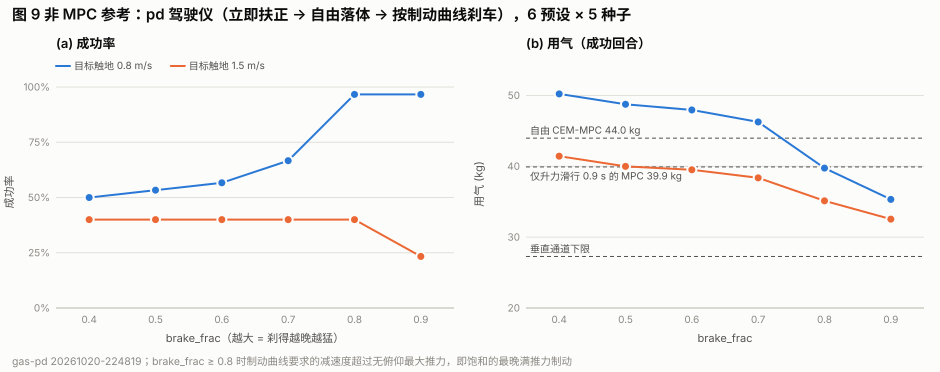
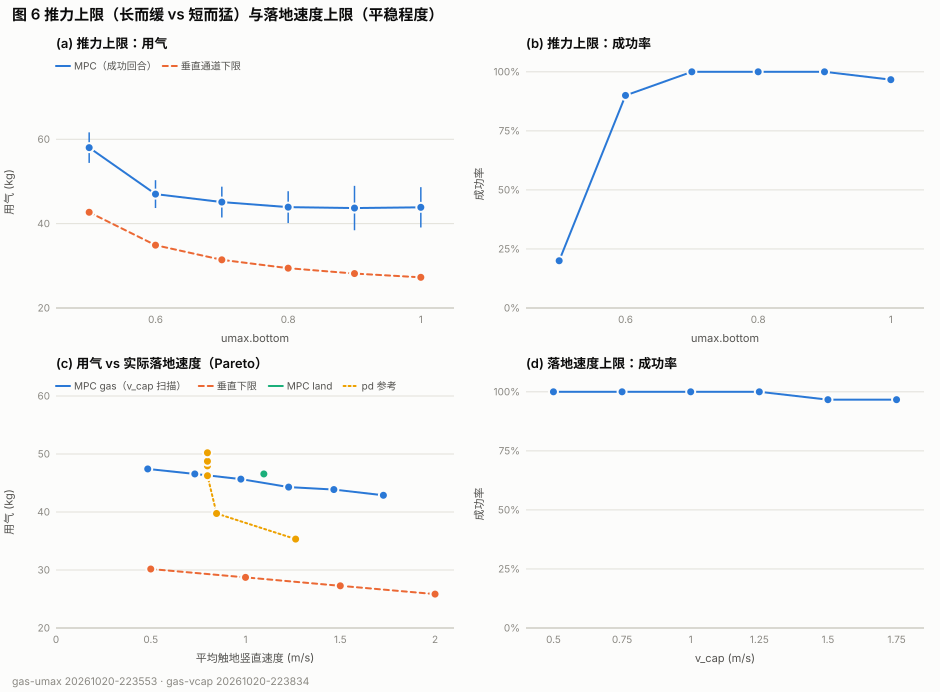
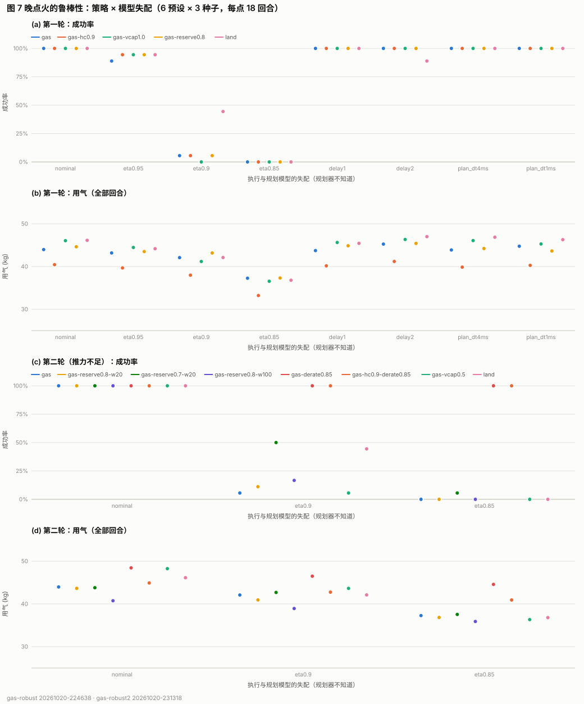

# 先自由落体、快到地面再喷，是否最省气？——纯 MPC 实验报告

> **2026-10-21 更新：底部喷口重新布置，本报告其余数字都是旧布局的**（底部喷口 z 0.55 / −0.95，不俯仰的最大升力
> 26.6 kN，T/W 2.36）。新布局 z 0.34 / −1.16（形心落在用掉约 45 kg 后的质心上）：不俯仰的最大升力 33.7–34.9 kN，
> T/W 3.0–3.2。`gas-robust` 重跑（`experiments/runs/gas-robust/20261021-003649`，同样 18 回合 / 变体）：
> - 标称：全部仍是 100 %，用气基本不变（gas 44.0 → 45.0 kg，gas-hc0.9 40.4 → 38.7，vcap1.0 46.0 → 47.0，
>   reserve0.8 44.6 → 43.6，land 46.1 → 46.3）。
> - **推力比模型小 10 %**：gas 6 % → 56 %，gas-hc0.9 6 % → 67 %，vcap1.0 0 % → 67 %，reserve0.8 6 % → 67 %，
>   land 44 % → 94 %。**小 15 %**：gas 0 → 11 %，gas-hc0.9 0 → 0 %，vcap1.0 0 → 17 %，reserve0.8 0 → 17 %，land 0 → 61 %。
> - 结论不变（晚燃烧对推力误差敏感，规划时要留推力余量），但余量从"零"变成了"约 10 %"。
>   `tools/flight/gas/lib.mjs` 的无俯仰升力分配已改为两对喷口哪边力臂长就收哪边（质心在燃烧中会越过形心）。

> **一句话结论**：是。保证平稳落地的前提下，制动这件事本身"先自由落体、最后用最大推力短促制动"是严格最省气的（理论 + 真实推进模型 + MPC 扫描一致）；但在这个任务里车离开甲板时就在翻滚，所以"自由落体"只能是升力通道的自由落体，姿态必须先修正，而且最晚的满推力燃烧对推力误差极不鲁棒，需要在规划模型里留余量。

**关键数字**（刚体孪生体，escape-soft-landing，6 个预设，种子 1–5，spec `7d600dc9c74828c8`）

| | 用气 | 成功 | 说明 |
|---|---|---|---|
| 理论下限（竖直通道，摆正无转动，v_td 1.5 m/s） | **27.3 kg** | 30/30 | 最晚点火 + 无俯仰最大推力 26.6 kN，点火在触地前 0.64 s |
| 同上，但点火提前 0.3 / 0.7 s（油门调到同一落地速度） | 35.8 / 59.3 kg | | 越早越缓越费气 |
| MPC（CEM）+ land 目标（主导者） | 46.6 kg | 30/30 | 触地 1.10 m/s |
| MPC（CEM）+ 无偏 gas 目标，自由 | 43.9 kg | 29/30 | 主燃烧在触地前 0.73 s；点火前已用 16 kg（主要是姿态修正） |
| MPC + gas，强制全部关闭滑行 0.3 / 0.6 / ≥0.8 s | 41.1 / 43.7 / – kg | 28 / 18 / 0 /30 | 车在空中翻转，来不及扶正 |
| **MPC + gas，仅升力滑行到解锁后 0.9 s（姿态自由）** | **39.9 kg** | **30/30** | 比自由 MPC −3.9 kg（95 % CI 2.7–5.0） |
| 非 MPC 参考 pd：立即扶正 + 自由落体 + 饱和的最晚制动 | **35.3 kg** | 29/30 | 全实验最省；同一驾驶仪刹得早（brake_frac 0.6）48 kg、17/30 |
| MPC 从悬停 / 早燃烧初值出发 | 66–120 kg | 2–15/18 | 滚动时域困在"缓降"盆地 |
| 底部推力比模型小 10 %：gas 各变体 / land / 降额规划 | – / – / 42.7 kg | 0–3/18、8/18、18/18 | 晚燃烧没有余量；按 85 % 推力规划即可 |
| 软体（flat / nose / roof）：仅升力滑行 MPC / 自由 gas MPC / land / pd | 39.5 / 42.6 / 43.6 / 34.4 kg | 0 / 0 / 0 / 1 (共 3) | 全部平稳触地，但软体后部触底（已知模型差，land 也一样） |

优化器：采样（CEM 最好、MPPI）从中性初值稳定收敛到"滑行 + 晚燃烧"；梯度法（主导者 grad、新增投影 L-BFGS `xlbfgs`）只有 6–56 % 成功（阀门死区让滑行附近梯度为零、曲率跨 10⁷、非凸），采样 → 梯度混合与采样相当，梯度精修不再省气；CEM 在约 200 rollouts/规划后饱和。


## 1. 问题与判据

**问题**：用 MPC（不用 PD；梯度、采样以及二者混合的优化器），在保证平稳落地的前提下，"一开始自由落体，快到了再喷"是不是最省气？

- 任务 `escape-soft-landing`（`spec/tasks/escape-soft-landing.json`）：汽车从高架（甲板顶面 9.2 m）护栏缺口冲出，质心越过甲板边缘时（约 0.78 s）推进器解锁（armed）。6 个发射预设 flat / nose / rear / side / roof / corner，种子决定速度 ±6 km/h、角度 ±2°、踢动强度 ×0.8–1.2。
- **平稳落地 = 任务成功判据**：触地竖直速度 |v_y| ≤ 2 m/s；触地时及之后 1 s 保持段内倾角 ≤ 12°；触地角速度 |ω| ≤ 1 rad/s；保持段结束前车身（hull 点）不触地（含滚进路缘）。
- **用气** = 整个回合的气体消耗（任务指标 `gas_used_kg`，满罐 145.7 kg）。
- 刚体孪生体（`coldgas-rigid@1`，JS）是主要实验模型；软体（XPBD 节点-梁模型）作为"真实世界"代理做少量验证。

## 2. 理论与参考解

### 2.1 一维最优控制：bang-bang（Meditch 1964）

只看竖直通道：高度 h、速度 v、质量 M，推力 F = u·F_max，质量流量 ṁ = u·ṁ_max，u ∈ [0, 1]：

ḣ = v，v̇ = u F_max / M − g（+ 小阻力），Ṁ = −u ṁ_max；目标 min ∫ṁ dt，终端约束 h(T) = 0 时 |v(T)| ≤ v_cap。

哈密顿量对 u 是线性的，所以最优控制是 bang-bang（只取 0 或 1），开关函数 S(t) = λ_v F_max / M − (1 + λ_M) ṁ_max 只变号一次：**先滑行（u = 0），再满推力（u = 1）一直推到触地**，触地速度恰好等于允许的 v_cap（Meditch 1964；Pontryagin 极小值原理）。直观解释是"重力损失"：制动所需的总冲量

J = ∫F dt = M (v_ign − v_cap) + M g t_burn （+ 阻力项），

第一项与何时点火无关（能量守恒决定了 v_ign 与 h_ign 的关系），第二项与燃烧时长成正比，因此燃烧越短越省：用最大推力、尽量晚点火。允许的触地速度越大，需要抵消的速度越少，也越省。

### 2.2 本推进模型下的修正（spec/README.md §3）

| 效应 | 对"晚点火最优"的影响 |
|---|---|
| 推力与阀门开度成正比（ṁ v_e 与压差项都 ∝ s），ṁ ∝ s | 哈密顿量仍对 u 线性 → 仍是 bang-bang |
| **后重的质心**：满罐质心 z = −0.433 m，在底部 4 个喷口形心（z = −0.20 m）之后 0.23 m | 4 个底部阀全开会以 ~9 rad/s² 俯仰（实测）；不产生俯仰力矩的最大升力是后排全开、前排 0.527：**F_max = 26.6 kN（T/W ≈ 2.36，净减速 ≈ 1.36 g）**，不是 34.9 kN / 3 g |
| 罐体多变膨胀（n = 1.25）降温：Isp 从 64.6 s（满罐）降到 62.0 s（用掉 40 kg 后） | Isp 只取决于**累计用气量**，与用气的时间先后无关 → 不改变时机的最优性，只让每 kg 稍弱 |
| 质量随用气减小 | 同上，与次序基本无关 |
| 阀门一阶滞后（开 15 ms / 关 10 ms），2 % 死区 | 点火需提前约 5–10 ms；死区让"微小开度"不可用（对梯度法重要，见 5.3） |
| 稳压器在用掉约 109 kg（75 %）后掉压 | 本任务用气 25–50 kg，从未触发（仅悬停类解接近） |
| 气动阻力 | 很小；高速下落时提供"免费制动"，晚点火时更大，有利于晚点火 |
| 控制周期 20 ms（50 Hz） | 见 2.3：最晚满推力点火的成功窗口只有约 8 ms，要靠油门微调补偿 |

### 2.3 参考解（真实孪生体物理，1 ms 分辨率）

工具 `tools/flight/gas/reference.mjs`：取每个（预设、种子）零推力下真实的弹道状态（离开甲板边缘 1.5 m、已离地），把姿态摆正、角速度清零（只剩竖直问题），然后在真实孪生体上做：

1. **bang-bang 点火时刻扫描**（2 ms 步长）：滑行到 t_ign，然后无俯仰力矩的满推力直到第一次触地；
2. **最晚点火的二分搜索**（1 ms 积分步）并在两个整数步之间线性插值到恰好 v_td = v_cap；
3. **恒定油门族**：对每个点火时刻求出恰好让 v_td = 1.5 m/s 的恒定油门 u 及其用气（等落地速度下比较"早点火 + 小推力"与"晚点火 + 满推力"）；
4. **推力上限**（umax.bottom 0.4–1.0）下的最晚点火解；
5. 解析解（常质量、常推力）与一维质点模型（同一推进 / 质量模型）对照；
6. 50 Hz 可执行版本（任务回合，`TaskTracker` 指标）：摆正起点，以及真实（旋转）起点不加姿态控制。


**结果（表 T1、图 1；`experiments/runs/gas-reference/20261020-215751`，6 预设 × 5 种子 = 30 个起点）**：

| 允许的触地速度 v_cap | 最少用气（整个回合） | 点火距触地 | dv_td / dt_ign | 满足任务判据 |
|---|---|---|---|---|
| 2.0 m/s | 25.85 ± 0.08 kg | 0.61 s | 123 m/s 每 s | 21/30（9 个在触地后约 0.1 s 后部车身触地） |
| **1.5 m/s** | **27.27 ± 0.08 kg** | **0.64 s** | 165 | 30/30 |
| 1.0 m/s | 28.73 ± 0.08 kg | 0.67 s | 241 | 30/30 |
| 0.5 m/s | 30.17 ± 0.09 kg | 0.70 s | 541 | 30/30 |

- **同一落地速度下，越晚、越猛越省**（图 1b、1c）：恒定油门、求解使 v_td = 1.5 m/s，点火每提前 0.1 s 多用约 2.3 kg；提前 0.3 s 为 35.8 kg（油门 0.58），提前 0.7 s 接近悬停式下降，59.3 kg（油门 0.43，+117 %）。这些长时间缓降还更容易失败：飞行时间长，横向漂移（约 16 m/s）把车带到路缘，触地后 0.5 s 车身撞路缘。
- **推力上限**（图 1d，v_td 1.5）：umax 1.0 / 0.9 / 0.8 / 0.7 / 0.6 / 0.5 → 27.3 / 28.2 / 29.4 / 31.4 / 34.9 / 42.7 kg，燃烧时长 0.64 → 1.97 s；0.4 时 T/W < 1，无法止住。
- **模型效应很小**：解析解（常质量常推力）27.2 kg，一维理想 27.0，一维真实推进 26.8，孪生体 27.3 kg。
- **时机极敏感**：满推力时成功窗口只有约 8 ms（flat s1，2 ms 步长扫描：起点后 0.700 s 点火在空中停住、不触地，0.702–0.708 s 成功（0.90–1.93 m/s），0.710 s 已是 2.16 m/s）；1 ms 点火误差 ≈ 0.12–0.24 m/s 触地速度（v_cap 2.0–1.0）。50 Hz 控制步（20 ms）比窗口还宽，可执行版本在最后一个控制步边界点火并把油门微调到 0.95–1.00：摆正起点 30/30 成功，27.9 kg（+0.6 kg）。同样的指令用在真实（翻滚着的，起点角速度 1.8–3.2 rad/s）起点上 0/30 成功——触地时倾角 124–172°，全部车身触地。
- **孪生体的悬挂**：带套件时后轴静载已压在缓冲块上，1.9 m/s 触地后约 0.1 s 后部车身就会触地；1.64 m/s 不会。所以无偏目标用 v_cap = 1.5 m/s（任务上限 2 m/s 留 0.5 m/s 余量）。



**可能让"晚"不再最优的因素**，以及检验它们的实验：

| 因素 | 预期 | 检验 |
|---|---|---|
| 姿态修正：离开甲板边缘时车已在翻滚（flat 预设在零推力下约 2.3 rad/s 滚转，roof 更大）；底部喷口产生力矩时必然同时产生升力 | 纯"全部关闭"的自由落体不可行；姿态应尽早修正 | 5.4 强制滑行扫描（全部关闭 vs 仅升力关闭） |
| 推力余量 / 鲁棒性：最晚满推力点火没有余量 | 推力不足或延迟时失败 | 5.7 |
| 控制周期 20 ms、阀门滞后 15 ms | 需要提前一点、用油门微调 | 2.3（+0.6 kg） |
| 允许的触地速度与悬挂 | 1.9 m/s 时后部触底 | v_cap 扫描 5.6 |
| 横向漂移、路缘 | 晚燃烧飞行时间最短，反而有利 | 恒定油门族的失败、5.5 |
| 罐体降温、质量变化、稳压器掉压 | 与次序无关 / 未触发 | 2.2 |


## 3. 方法

### 3.1 MPC 结构（`src/flight/mpc/`，主导者的核心框架，未改动）

- 每 `replan` = 2 个控制步（40 ms）从当前 FlightState 重新规划；规划孪生体积分步 `plan_dt` = 2 ms（真实孪生体 1 ms），预测时域 3 s（从解锁时刻起足以覆盖触地 + 1 s 保持段）。
- 决策变量 θ：开环指令时间表，节点间隔 0.1 s、线性插值，共 31 个节点 × 7 个力/力矩通道（底部 heave / pitch / roll，尾部 surge / pitch_r / yaw，侧面 sway；`mixer: modes`）= **217 维**。热启动 = 上一次的计划平移。
- `coast`：解锁后强制全部阀门关闭的时长（规划和执行都生效）。
- 每次 rollout 都计数（`ctl.evals`），用于等预算比较。

### 3.2 无偏用气目标 `objectives/gas.js`（本工作流编写）

单位为"kg 当量"，用气权重 w_gas = 1；落地要求是**近乎硬的铰链罚项，在允许范围内恰好为零**——没有任何项奖励"早制动"或"晚制动"本身：

| 项 | 定义 | 默认 |
|---|---|---|
| 用气 | w_gas · rollout 内用气 kg | 1 |
| 触地（一次） | hinge(\|v_y\| − v_cap) + hinge(倾角 − 6°) + hinge(\|ω\| − 0.5 rad/s)，hinge(e) = w₁e + w₂e²（e > 0），同一步先于撞车计价 | v_cap 1.5 m/s；速度 30/300，倾角 200/2000（rad），角速度 30/300 |
| 保持段 | 触地后 1 s 内，倾角超过 8° 的部分 × 50 每步；车身触地 1000 并终止 rollout；保持段结束后什么都不计价，rollout 停止 | |
| 时域末端仍在空中 | 100 + 竖直通道 bang-bang 剩余用气（常质量解析解，即 1-D 问题的价值函数）+ 若满推力也止不住则计触地速度罚项；超过任务截止时间每秒 100 | |
| 可选（默认 0） | 空中姿态整形 air_tilt·(1 − cos 倾角)、air_rate·\|ω\|²；制动余量 reserve（鲁棒性实验）；路缘 | |

与主导者的 `land` 目标相比：`land` 在任务限值以内也付钱（w_vy 从 1 m/s 起、w_td_tilt 从 0° 起），而且有 w_stop（按 70 % 推力判断能否止住），都会把计划推向更早、更缓的制动。**仍然存在的偏置**（设计如此，见 7）：v_cap = 1.5 m/s 的余量（孪生体在约 1.7–1.9 m/s 时后部触底，见 2.3）、倾角/角速度余量、有限时域、规划模型（2 ms 积分步、刚体）。

### 3.3 优化器

| 名称 | 类别 | 每次规划的 rollouts | 说明 |
|---|---|---|---|
| `cem` | 采样 | 1 + 3×127 + 1 ≈ 383 | 默认 128 样本 × 3 次迭代，12 精英 |
| `mppi` | 采样 | ≈ 385 | 128 × 3，softmax 均值 |
| `grad` | 梯度 | ≈ 2×(218 + 线搜索) | 主导者的有限差分投影归一化下降，2 次迭代 |
| `xlbfgs`（新，`optim/x-lbfgs.js`） | 梯度（拟牛顿） | ≈ 2×218 + 线搜索 | 投影 L-BFGS（盒约束，Armijo 回溯），前向有限差分，步长 4 %（必须跨过 2 % 阀门死区） |
| `cem>xlbfgs` | 混合（采样 → 梯度精修） | ≈ 257 + 218 | |
| `xlbfgs>cem` | 混合（梯度 → 采样） | ≈ 218 + 129 | |
| `mppi>grad` | 混合 | ≈ 257 + 221 | 主导者基线中的混合 |
| `xinit`（新，阶段） | 冷启动 | – | 时变初值（`init` 只能每通道一个常数） |
| `xmask`（新，阶段） | 约束 | – | **仅升力滑行**：heave 通道在解锁后 t 秒内为 0，姿态通道自由（对照 `coast` 的全部关闭） |

冷启动初值：zero（全部关闭）、hover（heave 0.42 ≈ 重力）、early（heave 0.7）、late（`xinit`：解锁后 1.0 s 前关闭，1.05–1.45 s 满 heave）。

### 3.4 指标

- **点火时刻**：触地前第一个底部总推力 ≥ 60 % × 34.9 kN、且其后 3 步 ≥ 30 % 的控制步（`burnStats`）；同时报告点火距触地时间、点火高度、燃烧时长（底部推力 ≥ 30 % 的时长）、点火前用气。
- **用气去向**（`impulseStats`）：所有喷口出口速度相同，用气 ∝ 推力冲量；解锁→触地之间把冲量分成竖直分量（制动）和其余（倾斜、水平、纯力矩）。
- 成功率给 Wilson 95 % 区间；同一（预设、种子）配对比较给 t 区间。

## 4. 设置

- spec hash `7d600dc9c74828c8`（全部运行相同），代码基于 `7e0f227` 加主导者当晚未提交的 MPC 框架（`src/flight/mpc/`）。刚体孪生体 1 ms 积分步，控制 50 Hz。
- 种子 1–5（种子 0 与 1 抽到相同初始条件，故不用 0）；每个（预设、种子）对所有配置相同，可配对比较。
- 所有孪生体实验：`node tools/flight/gas/bench.mjs <config> workers=8`（`experiments/runs/<name>/<stamp>/`：`config.json`、`episodes.jsonl`、`summary.json`、`traj/`）。

| 配置 `experiments/configs/` | 问题 | 回合 | 运行 |
|---|---|---|---|
| （工具）`tools/flight/gas/reference.mjs` | 垂直通道理论与参考解 | 30 个起点 | `gas-reference/20261020-215751` |
| `gas-objective.json` | 目标函数偏置：land vs gas | 4 × 30 | `gas-objective/20261020-215516` |
| `gas-coast.json` | 强制全部关闭滑行 0–1.2 s | 13 × 30 | `gas-coast/20261020-215800` |
| `gas-hcoast.json` | 仅升力滑行 0–1.2 s | 13 × 30 | `gas-hcoast/20261020-220221` |
| `gas-optim.json` | 7 种优化器 × 4 种初值 | 28 × 18 | `gas-optim/20261020-220943` |
| `gas-budget.json` | 收敛 vs 预算 | 29 × 18 | `gas-budget/20261020-222550` |
| `gas-umax.json` | 推力上限 0.5–1.0 | 6 × 30 | `gas-umax/20261020-223553` |
| `gas-vcap.json` | 落地速度上限 0.5–1.75 | 6 × 30 | `gas-vcap/20261020-223834` |
| `gas-attitude.json` | 空中姿态整形（搜索辅助） | 12 × 30 | `gas-attitude/20261020-224122` |
| `gas-pd.json` | 非 MPC 参考：pd 驾驶仪 | 12 × 30 | `gas-pd/20261020-224819` |
| `gas-explore.json` | MPC 搜索设置（力矩探索、σ、样本、重规划频率） | 7 × 30 | `gas-explore/20261020-230842` |
| `gas-robust.json` | 鲁棒性：5 策略 × 8 种失配 | 40 × 18 | `gas-robust/20261020-224638` |
| `gas-robust2.json` | 鲁棒性第二轮：制动余量、降额规划模型、v_cap 0.5 × 推力不足 | 24 × 18 | `gas-robust2/20261020-231318` |
| （工具）`tools/flight/gas/openloop.mjs` | 开环收敛（第一个规划问题） | 336 次 × 30k rollouts | `gas-openloop/20261020-225856` |
| （工具）`tools/flight/gas/conditioning.mjs` | 灵敏度 / 曲率 | 2 预设 × 3 时刻 | `gas-conditioning/20261020-221914` |
| （工具）`tools/flight/gas/soft.mjs` | 软体 | 4 策略 × 3 预设 | `soft-gas/` |


## 5. 结果

完整表格（含逐预设成功率）见 [`tables.md`](tables.md)（由 `node tools/flight/gas/report.mjs` 从运行目录生成），机器可读的数字在 `numbers.json`。

### 5.1 目标函数：land vs 无偏 gas（表 T2）

| 目标 | 成功 | v_td | 触地倾角 | 用气 | 点火距触地 | 点火前用气 |
|---|---|---|---|---|---|---|
| land（主导者，CEM 默认） | 30/30 | 1.10 m/s | 1.6° | 46.6 kg | 0.75 s | 17.8 kg |
| land，w_stop = 0 | 30/30 | 1.10 | 1.6° | 46.6 | 0.75 | 17.8 |
| **gas（本工作）** | 29/30 | 1.47 | 4.2° | **43.7**（成功 43.9） | 0.73 | 16.2 |
| gas + 空中姿态整形 | 29/30 | 1.47 | 3.6° | 43.5 | 0.74 | 15.6 |

- 配对：gas − land = **−2.4 kg**（95 % CI −3.7 … −1.1，29 对中 25 对更省）。gas 目标把触地速度和倾角用到上限（这正是"不为平稳本身付钱"）。
- **land 的 w_stop 实际上从不起作用**：w_stop = 0 与默认逐回合完全相同（30/30 位相同）。3 s 时域内每条 rollout 都已触地，而 w_stop 只在"时域末端仍在空中"时计价。land 多用的 2.4 kg 来自它为更软的落地付钱（v_ok = 1 m/s 以上、倾角从 0° 起），在 Pareto 图上它只比 gas 前沿高约 1 kg（5.6）。
- gas 目标的唯一失败（corner s5）：1.26 m/s 平稳触地，但车以约 20 m/s 在地面滚行，保持段第 0.95 s 底板中心撞上人行道路缘（hull 点 19）。

### 5.2 自由优化：优化器族 × 冷启动（表 T5、图 4）



每次规划约 400 rollouts，6 预设 × 3 种子：

| | zero | hover（heave 0.42） | early（heave 0.7） | late（xinit） |
|---|---|---|---|---|
| cem | 100 %，44.0 kg | 83 %，73.4 | 61 %，77.7 | 100 %，43.3 |
| mppi | 100 %，47.4 | 11 %，77.8 | 28 %，104.5 | 100 %，47.2 |
| grad（主导者） | 22 %，48.2 | 50 %，70.5 | 22 %，100.9 | 44 %，**40.1** |
| xlbfgs（新） | 17 %，51.0 | 39 %，78.1 | 6 %，119.8 | 56 %，44.3 |
| cem > xlbfgs | 100 %，43.8 | 44 %，77.6 | 56 %，95.7 | 94 %，43.5 |
| xlbfgs > cem | 100 %，45.4 | 11 %，66.0 | 17 %，103.2 | 100 %，43.0 |
| mppi > grad | 94 %，46.1 | 11 %，80.0 | 17 %，98.7 | 100 %，45.5 |

（成功率，成功回合的平均用气）

- **从中性（zero）或晚燃烧初值出发，采样法与"采样参与"的混合法都收敛到"大部分时间滑行、触地前约 0.7 s 主燃烧"**：主燃烧点火距触地 0.71–0.87 s（垂直最优 0.64 s），100 % 成功，43–47 kg。
- **从悬停或早燃烧初值出发，所有优化器都被困在"长时间缓慢燃烧"的局部最优里**：66–120 kg（多用 50–170 %），点火距触地 1.2–3.0 s，点火前就用掉 27–99 kg，成功率 6–83 %（失败的 170 回合里 135 个是悬停到 6 s 仍未着陆，15 个车身触地）。滚动时域使早期决定无法撤销：一旦早期推力已经把车减速，那部分气已经花掉，后续规划只能优化剩下的下降。这本身就是"早喷更费气"的证据。
- **纯梯度法不可靠**（6–56 %，主要失败是车身触地）。grad 从晚燃烧初值得到本表中最低的用气（40.1 kg），但只有 8/18 成功。投影 L-BFGS 比主导者的归一化下降好一点（zero 初值、更大预算下 56 % vs 44 %，见 5.3），但仍不够用。
- 混合：先采样后梯度（cem > xlbfgs）与 cem 相当，梯度精修没有再降低用气；先梯度后采样（xlbfgs > cem）也与 cem 相当（采样部分在起作用）。

### 5.3 预算与可微性（表 T6、图 5、表 T10、图 8）



- **采样法在约 200 rollouts/规划时饱和**：CEM 16×3（53 /规划）78 %，54.4 kg → 64×3（214）100 %，44.6 → 512×3（1731）100 %，43.5 kg。8 倍算力只再省约 1 kg。MPPI 64×3 起 100 %，44.5–47.4 kg。所以自由 MPC 停在 ~43 kg 不是算力问题。
- **梯度法加预算也不收敛**：grad 1/2/4/8 次迭代 → 6/22/44/28 %；xlbfgs 1/2/4/8 → 6/17/56/56 %；中心差分 6 %；SPSA 22–44 %（77–82 kg）。**降维有用**：xlbfgs 用增长节点（knot_growth 1.15，98 维）为 83 %、50.2 kg，只需 254 rollouts/规划（同样的粗网格让 CEM 变差：56 %）。
- **为什么梯度射击在这里病态**（`tools/flight/gas/conditioning.mjs`，`gas-conditioning/20261020-221914`，CEM 计划处、4 % 步长的中心差分）：解锁后 0.8 s 的计划（flat / roof）中，217 维里有 63 / 70 维的有限差分灵敏度**恰好为 0**（阀门开度低于 2 % 死区，或节点已在触地之后）；|∂J/∂θ| 最大 7495 / 6161，中位数只有 24 / 1.7；正曲率最大与最小相差约 10⁷；18 / 11 维为负曲率（非凸）。另外，解锁时和 +0.4 s 时 CEM 自己的计划在模型里仍预测车身触地（代价 3–14 × 10³）：**闭环之所以成功，靠的是不断重规划，而不是第一个计划好**。代价面平坦（死区）、刚性（不稳定的姿态：早期力矩节点对触地状态的影响比后期升力节点大几个数量级）、非凸、并有接触事件造成的不连续——采样法对这四点都不敏感。


- **开环收敛**（`tools/flight/gas/openloop.mjs`，`gas-openloop/20261020-225856`，表 T10、图 8）：只解解锁时刻的第一个规划问题（不执行、不重规划），每个优化器 × 初值 × 12 个起点（6 预设 × 种子 1–2）给 30 000 rollouts（约为闭环一整个回合的预算）。**336 次里只有 7 次得到可行计划**（cem 4、mppi 1、xlbfgs > cem 1、mppi > grad 1），可行计划用 56–67 kg。从 zero / late 出发，CEM 与 MPPI 的代价中位数一直在下降（30k 时仍约 300，未收敛）；grad 与 xlbfgs 很快停住（10³·⁸–10⁴·³）。从 hover / early 出发，所有方法都很快停在约 160——"在空中缓降、时域内不着陆"的计划（100 的在空中罚项 + 约 55 kg），是局部方法最容易到达的盆地。结论：从解锁时刻一次性解出整条轨迹对所有方法都太难；MPC 在闭环中靠反馈（每 40 ms 重规划）逐步把计划变成可行的。

### 5.4 核心扫描：强制滑行（表 T3、T4、T12、图 2）



| 解锁后滑行 | 全部阀门关闭：成功 | 用气（成功） | 仅升力关闭：成功 | 用气（成功） |
|---|---|---|---|---|
| 0 s（自由） | 97 % | 43.9 kg | 97 % | 43.9 kg |
| 0.3 s | 93 % | 41.1 | 100 % | 44.3 |
| 0.5 s | 73 % | 42.4 | 100 % | 43.1 |
| 0.6 s | 60 % | 43.7 | 100 % | 42.7 |
| 0.7 s | 13 % | 41.3 | 100 % | 42.0 |
| 0.8 s | 0 % | – | 97 % | 41.3 |
| **0.9 s** | 0 % | – | **100 %** | **39.9** |
| 1.0 s | 0 % | – | 100 % | 40.5 |
| 1.1 s | 0 % | – | 100 % | 41.9 |
| 1.2 s | 0 % | – | 93 % | 43.1 |

（每行 30 回合；垂直通道最优的点火时刻是解锁后约 0.99 s）

- **"全部关闭"的自由落体**：解锁后最多约 0.2–0.3 s 还安全；再长，车在空中翻转太多（滚转持续累积），剩下的时间来不及扶正，成功率从 93 % 降到 0 %；垂直通道最优要求的约 1.0 s 自由落体在这个任务里**完全不可行（0/30）**。配对（两者都成功的回合）：滑行 0.3 s 比自由省 2.6 kg（CI 1.1–4.0），成功少 1 个（28 vs 29/30）；滑行 0.6 s 多用 2.1 kg（CI 0.2–3.9），成功少 11 个（18 vs 29/30）。
- **"仅升力关闭"（姿态通道一直可用）**：所有滑行时长都 93–100 % 成功，用气随滑行变长而下降，在 **0.9 s 处最低（39.9 kg）**，之后又上升。配对：0.9 s 比自由 **−3.9 kg（CI −5.0 … −2.7，29 对中 26 对更省）**；1.2 s 与自由相当（+0.05，CI −1.4 … 1.5）。最优点正好在垂直通道理论给出的点火时刻附近（掩码让升力从 0.9 s 后的第一个节点开始爬升，即 0.9–1.0 s），主燃烧点火距触地 0.67 s（理论 0.64 s）。
- 点火前用气在仅升力滑行中几乎恒定（约 14 kg）：那是姿态修正的代价（底部喷口单侧推力既产生力矩也产生升力）。

### 5.5 用气去向、姿态与非 MPC 参考（表 T13、T14、T16、图 3、图 9）



- **用气 ∝ 推力冲量**，把解锁 → 触地的冲量分成竖直分量与其余：自由 gas 目标的竖直占比 η_up = 0.72（12.3 kg 用在倾斜 / 水平 / 纯力矩上），land 0.82（8.2 kg），仅升力滑行 0.9 s 为 0.80（8.1 kg）；飞行时间 1.86–2.06 s，而垂直参考只有 1.63 s（更长的飞行 = 更多重力损失）。其中竖直（制动）部分约 30–35 kg，比 27.3 kg 的下限多出的部分来自更长的飞行。**MPC 与理论下限之间约 12 kg 的差距，主要是姿态：推力不竖直，以及扶正过程拖长了飞行。**
- 图 3（flat s1）：所有 MPC 策略都让车先滚到 30–80°，再在主燃烧中扶正。
- 空中姿态整形（只当搜索辅助）让峰值倾角下降（种子 1 的 6 个回合平均 85° → 67°），但**用气不变**（配对 +0.3 / +0.7 kg，CI 包含 0）。


- **非 MPC 参考 pd**（表 T16）：它就是把假设写成反馈律——用 50 Hz 姿态反馈立即扶正、然后自由落体、最后按制动曲线刹车（brake_frac ≥ 0.8 时要求超过无俯仰力矩最大推力，即饱和的 bang-bang）。brake_frac 0.9、td 0.8：**30 回合 97 % 成功、35.3 kg、v_td 1.26 m/s，主燃烧点火距触地 0.64 s（与垂直最优相同）**，点火前只用 8.9 kg；0.8：97 %，39.7 kg；默认 0.6：57 %，48.0 kg；0.4：50 %，50.2 kg。**刹得越晚越猛，既更省气又更成功**（飞行短，漂不到路缘）。td 1.5 m/s 时只有 23–40 %（1.5–2 m/s 触地后后部车身触地）。它比自由 MPC 少用 8.6 kg，比最好的仅升力滑行 MPC 少 4.6 kg——这是"先摆正、自由落体、最后猛刹"最省气的最直接证据，也说明这里的 MPC 没有找到全局最优（见 5.3 与下一条）。
- **能否把 MPC 调到 pd 的解？**（表 T15，`gas-explore/20261020-230842`，每行 30 回合）：把力矩通道的探索加倍（channel_scale pitch / roll 1）反而更费气——自由 52.8 kg、仅升力滑行 50.5 kg；再加大 σ（0.2）到 55–62 kg，256 样本 + 30 次冷启动迭代也只有 55.2 kg（97 %）。原因是开环时间表里的力矩噪声让姿态随机游走，纠正它又要花气（主导者 README 已提到"open-loop torque noise random-walks the attitude"）。每 20 ms 重规划（replan 1）：40.0 kg，与 40 ms（39.9 kg）相同。**在本框架（开环指令表 + 滚动时域）里，最好的 MPC 是"仅升力滑行到 0.9 s"的 CEM，约 40 kg；pd 那种"高增益姿态反馈 + 自由落体 + 饱和制动"（35.3 kg）不在它的搜索可达范围内。**

### 5.6 推力上限（长而缓 vs 短而猛）与平稳程度（表 T7、T8、图 6）



| umax.bottom | 0.5 | 0.6 | 0.7 | 0.8 | 0.9 | 1.0 |
|---|---|---|---|---|---|---|
| MPC 成功 | 20 % | 90 % | 100 % | 100 % | 100 % | 97 % |
| MPC 用气（成功） | 58.0 kg | 47.0 | 45.1 | 43.9 | 43.7 | 43.9 |
| 燃烧时长 | 2.06 s | 1.50 | 1.36 | 1.17 | 1.04 | 1.02 |
| 垂直下限 | 42.7 kg | 34.9 | 31.4 | 29.4 | 28.2 | 27.3 |

- 短而猛更省：与理论同号。MPC 在 0.8–1.0 之间持平，因为它的主燃烧本来就在约 25 kN（无俯仰最大值的 94 %），剩下的余量留给姿态差动。配对 umax 0.7 − 1.0 = +1.3 kg（CI 0.3–2.3）。
- 落地速度上限 v_cap 0.5 / 0.75 / 1.0 / 1.25 / 1.5 / 1.75 → 47.4 / 46.6 / 45.7 / 44.3 / 43.9 / 42.9 kg，成功 97–100 %：每多允许 1 m/s 约省 3 kg，与理论斜率一致（30.2 → 25.8 kg）。配对 v_cap 1.0 − 1.5 = +2.0 kg（CI 1.1–2.9）。land 目标（1.10 m/s，46.6 kg）比 gas 前沿高约 1 kg。

### 5.7 晚燃烧的鲁棒性（表 T9、T9b、图 7）



执行时引入规划器不知道的失配（`tools/flight/gas/lib.mjs` `wrapExec`），每格 18 回合：

| 策略 | 标称 | 推力 ×0.95 | ×0.9 | ×0.85 | 延迟 1 步 | 延迟 2 步 | plan_dt 4 ms |
|---|---|---|---|---|---|---|---|
| gas（自由） | 100 %，44.0 kg | 89 % | 6 % | 0 % | 100 % | 100 % | 100 % |
| gas，仅升力滑行 0.9 s | 100 %，40.4 | 94 % | 6 % | 0 % | 100 % | 100 % | 100 % |
| gas，v_cap 1.0 | 100 %，46.0 | 94 % | 0 % | 0 % | 100 % | 100 % | 100 % |
| gas，v_cap 0.5 | 100 %，48.3 | – | 6 % | 0 % | – | – | – |
| gas，制动余量 0.8（w 2 / 20 / 100） | 100 %，44.6 / 43.6 / 40.7 | 94 %（w 2） | 6 / 11 / 17 % | 0 % | 100 %（w 2） | 100 %（w 2） | 100 %（w 2） |
| gas，制动余量 0.7（w 20） | 100 %，43.8 | – | 50 % | 6 % | – | – | – |
| land | 100 %，46.1 | 94 % | 44 % | 0 % | 100 % | 89 % | 100 % |
| **gas，降额规划模型 0.85** | 100 %，48.4 | – | **100 %** | **100 %** | – | – | – |
| **gas，仅升力滑行 0.9 s + 降额 0.85** | 100 %，**44.9** | – | **100 %，42.7** | **100 %，40.9** | – | – | – |

- **延迟与模型步长不是问题**：1–2 个控制步的指令延迟、4 ms 规划步长，所有策略仍 89–100 %（每 40 ms 重规划能吸收）。
- **推力不足是晚燃烧的命门**：底部推力比模型小 10 % 时，所有按标称推力规划的 gas 变体都几乎全部失败（0–17 %），触地 2.4–3.0 m/s 或车身触地；land 也只有 44 %，小 15 % 时全部失败。原因正是 2.3 节的灵敏度：最晚的满推力燃烧没有剩余推力，发现不足时已经来不及。**落地速度余量（v_cap 0.5–1.0）帮不上忙**：速度缺口在燃烧中累积到 1–2.5 m/s，远大于任何合理的触地余量。目标中的制动余量（reserve，按 70–80 % 的减速能力规划）只部分有效（最多 50 %），它是软约束，计划仍然会去贴近极限。
- **有效的做法是降额规划模型**：规划时假设底部推力只有 85 %（umax.bottom 0.85），执行时把指令放大 1/0.85——计划仍然是"滑行 + 晚燃烧"，只是按较弱的发动机算点火时刻，真正的满推力留给重规划。三种推力水平下 100 % 成功；代价是标称推力时多用约 4.5 kg（仅升力滑行版 44.9 vs 40.4 kg），推力确实不足 15 % 时反而只用 40.9 kg。
- 软体上无法做这个包装（`tools/sim/flight.mjs` 直接把注册表控制器接到推进器上），见 5.8。

### 5.8 软体验证（表 T11，`experiments/runs/soft-gas/`）

`node tools/flight/gas/soft.mjs presets=flat,nose,roof only=gas,gas-hc0.9,land,pd-b0.9 par=4 dur=5`（软体 XPBD 模型闭环，ThrusterRig 的状态估计，预设的标称初始条件，每个约 2–6 min）：

| 策略 | flat | nose | roof | 平均用气 |
|---|---|---|---|---|
| gas（自由 CEM） | 1.46 m/s，40.4 kg | 1.43，39.9 | 1.44，47.6 | 42.6 kg |
| gas，仅升力滑行 0.9 s | 1.43，38.8 | 1.53，37.5 | 1.46，42.2 | **39.5 kg** |
| land（主导者） | 1.08，39.4 | 1.19，42.8 | 0.74，48.6 | 43.6 kg |
| pd，brake_frac 0.9（非 MPC） | **1.47，32.3 ✓** | 1.46，33.2 | 1.29，37.7 | **34.4 kg** |

- **用气排序与孪生体一致**：pd < 仅升力滑行 MPC < 自由 gas MPC ≈ land；仅升力滑行比自由 gas 平均省 3.1 kg，比 land 省 4.1 kg（孪生体上为 3.9 / 6.7 kg）。所有运行都平稳触地（0.74–1.53 m/s，触地倾角 ≤ 5.2°，|ω| ≤ 0.47 rad/s）。
- **但 12 次里只有 1 次（pd flat）满足全部判据**：其余 11 次都在触地后 0.15–0.32 s 车身触地，包括主导者的 land MPC（触地 0.74–1.19 m/s）。这正是主导者记录过的软体与孪生体的模型差（软体后部在约 7 cm 的离地间隙内触底，孪生体的硬缓冲块不会；参见 experiments/README.md 的 mppi-soft 设置 `bottom_gate` 等），与晚燃烧无关：最软的 land-roof（0.74 m/s）同样触底。pd flat 的车身触地发生在触地后 2.2 s（保持段之后），计为成功。
- 降额规划模型（5.7）无法在软体上试：`tools/sim/flight.mjs` 直接把注册表控制器接到推进器，没有执行包装的位置。


## 6. 回答

**是——在"保证平稳落地"的前提下，最省气的就是"尽量自由落体、快到地面时用（接近）最大推力短促制动"；但在这个任务里有两个必须说清楚的条件。**

1. **对制动本身（竖直通道）严格成立。** 理论（哈密顿量对油门线性 → bang-bang，Meditch 1964）、真实推进模型的参考解与 MPC 实验同号：同一触地速度下，点火每提前 0.1 s 多用约 2.3 kg，悬停式缓降多一倍以上（59 vs 27 kg）；推力上限越低越费（0.5 → +57 %）；允许的触地速度每多 1 m/s 省约 3 kg。罐体降温（Isp 64.6 → 62 s）、质量变化、阀门滞后、稳压器都不改变这一点（它们与用气的时间先后基本无关）。最省气的点火在触地前约 0.64 s、离地约 3.7 m（v_td 1.5 m/s，27.3 kg）。
2. **"自由落体"只能指升力通道，姿态必须先修正。** 车离开甲板边缘时已经在翻滚（flat 预设零推力时约 2.3 rad/s，roof / corner 更大），而底部喷口产生力矩时必然同时产生升力。强制全部阀门关闭超过解锁后约 0.3 s，成功率就从 93 % 掉到 0 %（理论上的 1.0 s 自由落体 0/30）。保留姿态通道、只让升力通道自由落体到解锁后 0.9 s（≈ 理论点火时刻），MPC 用气最低：39.9 kg、30/30，比无约束 MPC 少 3.9 kg（CI 2.7–5.0），比 land 目标少约 6.7 kg。最直接的证据是非 MPC 的 pd 驾驶仪：立即扶正、自由落体、饱和的最晚制动，**35.3 kg、97 %**；同一驾驶仪刹得越早越费气、越容易失败（brake_frac 0.6：48 kg、57 %）。
3. **MPC 自己能找到"晚燃烧"，但找不到全局最优。** 采样法（CEM、MPPI）及含采样的混合法从中性初值稳定地收敛到"大部分时间滑行、触地前约 0.7 s 主燃烧"（100 % 成功，43–47 kg），预算超过约 200 rollouts/规划后不再改善；它们让车先滚到 30–80° 再在主燃烧中扶正，约 12 kg 的气花在不竖直的推力和更长的飞行上。从悬停或早燃烧初值出发，所有方法都困在 66–120 kg 的"缓降"局部最优（滚动时域不会撤销已经花掉的气）。纯梯度法（主导者的 grad、本工作的投影 L-BFGS）只有 6–56 % 成功：阀门死区让滑行附近的代价完全平坦，曲率跨 10⁷，非凸，有接触事件——这本身是一个结论：这类问题上梯度射击病态，采样更合适，梯度精修不再带来收益。
4. **代价是鲁棒性。** 最晚的满推力燃烧没有余量：底部推力比模型小 10 % 时，按标称推力规划的所有 gas 变体几乎全部失败（触地速度余量帮不上）。把余量放在规划模型里（按 85 % 推力规划、执行时可用满推力）可以在推力不足 15 % 时仍 100 % 成功，标称时多用约 4.5 kg（44.9 vs 40.4 kg）——仍然是晚燃烧，只是按更弱的发动机计算点火时刻。指令延迟 1–2 步、规划步长 4 ms 不构成问题。
5. **软体上排序不变**（仅升力滑行 MPC 比自由 MPC 省 3.1 kg、比 land 省 4.1 kg，pd 最省），但软体在触地后 0.15–0.3 s 后部触底（所有 MPC 策略包括 land 都一样），这是已知的软体 / 孪生体模型差，需要主导者的软体专用设置来解决，不影响"晚燃烧更省气"的结论。


## 7. 局限

- **刚体孪生体是主要证据**：软体只做了少量验证（5.8）。孪生体的悬挂（后轴静载在缓冲块上）、只有方盒碰撞体的路缘、不转动的车轮等简化决定了"多快的触地会撞车身"和"路缘在哪里"。
- **MPC 没有找到全局最优**：非 MPC 的 pd 参考比任何 MPC 解都省 4–9 kg。所以"MPC 与下限之间的差距"有一部分是优化器 / 参数化的问题（开环指令表、217 维、滚动时域、第一个计划不可行），不只是物理。本报告的结论建立在三条相互独立的证据上（理论参考解、受控滑行扫描、pd 参考），而不只是 MPC 自由优化的结果。
- 无偏目标仍有设计选择：v_cap = 1.5 m/s、倾角 6°、角速度 0.5 rad/s、保持段 8° 的余量，以及 3 s 时域（末端在空中用一维 bang-bang 剩余用气估价，不含姿态）。改变余量会平移数字（5.6），不改变"越晚越猛越省"的方向。
- 梯度法只用了有限差分（孪生体不可微）；没有实现 iLQR / DDP：代价由接触事件（第一次触地、车身触地）决定，状态空间里没有光滑的阶段代价可用，而对 θ 的有限差分已经显示出死区平坦与 10⁷ 的曲率跨度。
- 冷启动 late 初值（xinit）用的是一个固定时刻表（解锁后 1.0–1.45 s 满升力），不随预设调整。
- 每个配置点 18–30 回合：成功率区间较宽（例如 30/30 的 95 % 区间是 89–100 %）；用配对比较来减小方差。
- "用气 ∝ 推力冲量"的分解假设所有喷口出口速度相同（相同扩张比、同一供气压力和温度，成立）；η_up 只统计解锁 → 触地。

## 8. 复现

```sh
# 理论 / 参考解（单线程，约 50 s）
node tools/flight/gas/reference.mjs seeds=1,2,3,4,5
# 配置（由脚本生成，已提交）
node tools/flight/gas/configs.mjs
# 孪生体实验（每个 2–20 min，8 个 worker）
for c in gas-objective gas-coast gas-hcoast gas-optim gas-budget gas-umax gas-vcap gas-attitude gas-pd gas-explore gas-robust gas-robust2; do
  node tools/flight/gas/bench.mjs experiments/configs/$c.json workers=8
done
node tools/flight/gas/openloop.mjs budget=30000 seeds=1,2 workers=8      # 开环收敛
node tools/flight/gas/conditioning.mjs                                    # 灵敏度 / 曲率
node tools/flight/gas/soft.mjs presets=flat,nose,roof par=4                # 软体（每个约 3 min，单线程）
# 图与表（读取每个实验最新的运行；指定：gas-coast=<stamp> ...）
node tools/flight/gas/report.mjs
# 单个回合
node tools/flight/run.mjs task=escape-soft-landing controller='{"name":"mpc","objective":"gas","optimizer":[{"type":"xmask","heave_until":0.9},{"type":"cem"}]}' seed=1 preset=flat out=x.json
```

所有运行是确定性的（同一 spec hash、配置、种子 → 同一回合）。

## 9. 附：对主导者（框架）的发现

1. `land` 的 `w_stop` 在默认 3 s 时域下**从不生效**（w_stop = 0 时 30/30 回合逐位相同）：它只在"时域末端仍在空中"时计价，而每条 rollout 都已触地。`land.js` 头注释里"w_stop biases plans towards braking earlier"的提醒对默认设置不成立；land 多用的气来自它在任务限值以内也为触地速度 / 倾角付钱。
2. **底部喷口不是"关于质心对称"**（spec/README.md §2 的说法）：带套件满罐质心 z = −0.433 m，在 4 个底部喷口形心（−0.20 m）之后。4 阀全开会以 ~9 rad/s² 俯仰；无俯仰的最大升力是 26.6 kN（T/W 2.36），不是"34.8 kN ⇒ ≈3 g"。`pd` 的 a_max 用的是 34.9 kN（因此 brake_frac ≥ 0.8 时饱和），`land` 的 `bottomThrustNominal()` 同样是 4 阀全开。
3. `param.js` 的 heave 模态在满罐质心处求解；用气后质心前移（用掉约 45 kg 时到 −0.41 m，平衡所需的前排比例从 0.527 变为 0.567），纯 heave 满指令因此带约 0.66 kN·m 的俯仰力矩，需要靠 pitch 通道补偿。
4. 阀门 2 % 死区让小开度的有限差分完全平坦：`grad` 的默认步长 0.02 × 盒宽对 heave 正好落在死区边上，对前排喷口（heave 系数 0.527）则在死区之内；在全部关闭的时间表附近梯度看不到任何东西。`grad` 遇到零宽度盒（例如 `xmask` 收窄的盒）会 0/0 → NaN 并停止，不是 bug，但要知道。
5. MPC 的 `init` 只能是每通道常数（本工作用 `xinit` 阶段补充时变初值）；没有"执行与规划模型失配"的钩子（本工作在 `tools/flight/gas/lib.mjs` 的 `wrapExec` 里包装控制器）。
6. `land` 的 rollout 在保持段结束后仍继续模拟到时域末端：gas 目标在保持段结束时停止 rollout，每回合约 7 s（land 约 14 s）。
7. 第一次规划（first_passes 10 × 383 rollouts）在多数情况下仍预测车身触地；成功完全依赖重规划。对软体这类慢模型，这意味着第一个 0.4 s 的指令质量取决于运气。

## 10. 本工作新增 / 修改的文件

- `src/flight/mpc/objectives/gas.js`（无偏用气目标，替换占位）、`src/flight/mpc/optim/extra.js`（注册）、`src/flight/mpc/optim/x-lbfgs.js`（投影 L-BFGS）、`src/flight/mpc/optim/x-stages.js`（`xinit`、`xmask`）。
- `tools/flight/gas/`：`lib.mjs`、`reference.mjs`、`bench.mjs`、`summary.mjs`、`configs.mjs`、`openloop.mjs`、`conditioning.mjs`、`soft.mjs`、`svg.mjs`、`report.mjs`。
- `experiments/configs/gas-*.json`、本目录（README、tables.md、numbers.json、fig-*.svg）。
