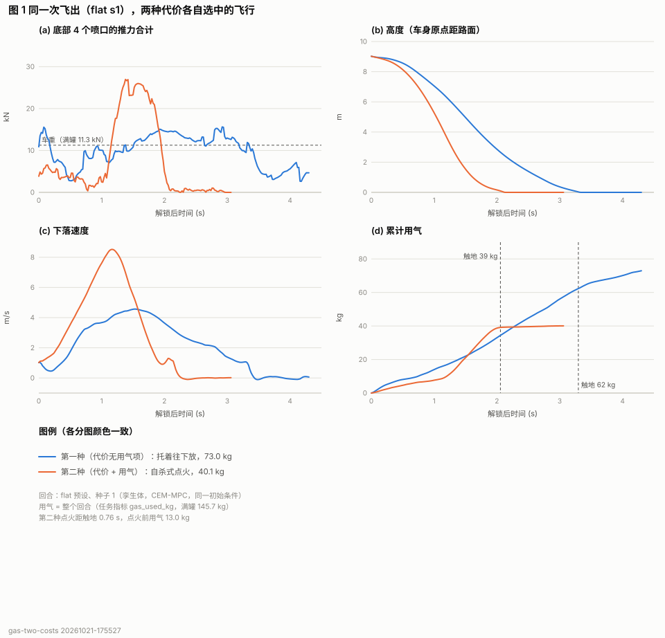
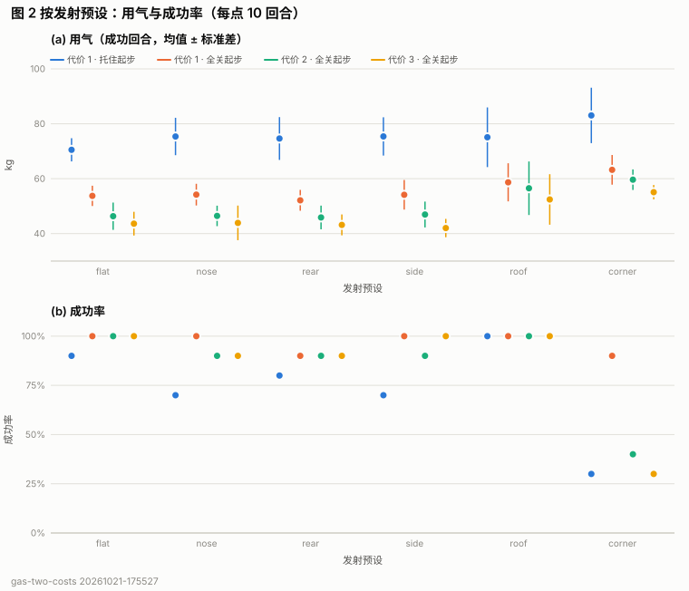
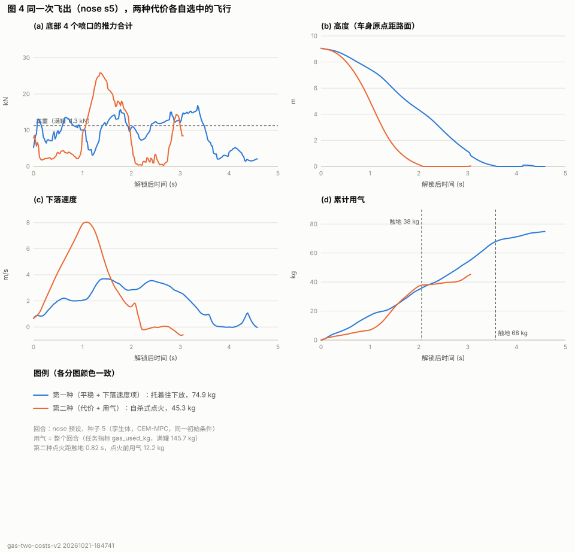
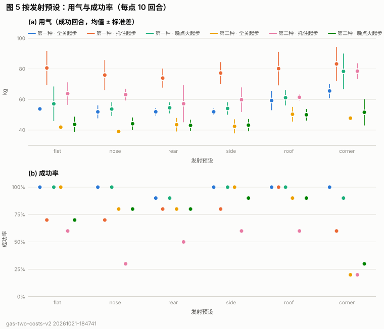

# 托着往下放 vs 自杀式点火：两种代价下的 MPC 与耗气量（FALL 文案 03a–05c 的两个实验）

> **最新（第 10 节，v2，与 2026-10-21 晚改过的文案 03a 一致）**：第一种代价 = 触地速度 / 倾角 + **下落中速度过快也计价**（`w_sink`），
> 第二种 = 第一种 + 用气（2 / kg）；同一个 MPC 从全关 / 托住 / 晚点火三个起点出发，先筛成功、再按整趟代价挑。4 个正着飞出的预设：
> 第一种在托着能按时落地的 30 例里 25 例选托着（平均好 10.3 分，95 % 区间 6.1–14.5），托着的飞行 78.5 kg；第二种 39 例成功里 36 例是晚点火，
> 43.2 kg，点火距触地 0.77 s。代表回合 nose s5（75 km/h）：**托着 74.9 kg，自杀式 45.3 kg，省四成**。05c 已按此填进文案。

> **一句话结论**：同一个纯 MPC（CEM，无 pd）用两种代价跑这个题。第一种代价只为"平稳"付钱，它选中的是托着车慢慢放：底部推力全程约等于车重，**用气约 74 kg**。第二种代价每公斤气再计 1 分，它选中的是自杀式点火：先控住翻滚，几乎关阀自由下坠，落地前约 0.7 s 才把底部阀门开到 96 %，**约 43–46 kg，省约四成**。两种做法飞行中的平均推力都约等于车重，所以用气几乎只取决于在空中待了多久（都是约 19 kg/s），托着多飞了约 1.1 s。
>
> **但有两个前提，文案用词要对得上**（第 2 节）：(1) 旧稿备注里那个实验，只把 `w_gas` 设成 0、其余不变，并**不会**让 MPC 托着车：它照样先自由落体再晚点火，只是更费气（54 kg 对 46 kg）。"托着"要靠 MPC 从"托住"这个初始方案出发，代价里又没有任何东西要它松手。(2) "加了用气项以后做法彻底变了"，要在 MPC 两个初始方案都试过、按整趟总代价挑的时候才成立，而且用气权重要够大（每 kg 1 分：34/40 选自杀式；现有 land 目标的 0.3 分：21/19，基本是掷硬币）。

> **补充（第 9 节）**：去掉触地后的软体失效判据、换成梯度 MPC（本仓库的 `xlbfgs` / `grad`，以及 `~/Downloads/ppo` 的 LTV-MPC 凸 QP）、或者只从"托住"出发把冷计划加大 10 倍，都**不能**让同一个起点只靠改代价得出这个结论；原因见 9.4。

刚体孪生体（`coldgas-rigid@3`，JS），任务 `escape-soft-landing`，spec `ebb8dc383efa4f9a`，代码基于 `784ef6e`
加本轮的两个可选项（第 5 节）。运行 `experiments/runs/gas-two-costs/20261021-175527`（6 控制器 × 6 预设 × 种子 1–10 = 360 回合）。

## 1. 给 05c 的数字

| | 第一种：代价里没有用气项（托着往下放） | 第二种：代价加上用气项（自杀式点火） | 第二种比第一种 |
|---|---|---|---|
| **代表回合**（flat 预设、种子 1，同一次飞出，图 1） | **73.0 kg** | **40.1 kg** | 少 45 % |
| 4 个正着飞出的预设 × 10 种子（成功回合均值） | 73.8 ± 6.5 kg（31/40 成功） | 43.2 ± 4.4 kg（38/40） | 少 41 % |
| 全部 6 个预设 × 10 种子（成功回合均值） | 74.7 ± 8.0 kg（44/60） | 45.7 ± 7.0 kg（51/60） | 少 39 % |
| 点火距触地（第二种） | — | 0.76 s（代表回合）；均值 0.71–0.73 s | |
| 点火前的"一小口气"（第二种） | — | 13.0 kg（代表回合）；均值 18–19 kg | |
| 解锁 → 触地 | 3.28 s（均值 3.2 s） | 2.04 s（均值 2.1 s） | |
| 最大下落速度 | 4.6 m/s（均值 4.5–5.1） | 8.5 m/s（均值 7.7–7.8） | |
| 底部推力 ≥ 车重一半的时间占比 | 91 %（均值 92 %） | 49 %（均值 61–66 %，含主燃烧） | |

建议的 05c："整趟只用了约 45 公斤气，而第一种用了约 75 公斤，多出六成多。"（如果想用代表回合："只用了 40 公斤，第一种用了
73 公斤"。）"约 45 公斤"与 6 预设均值 45.7 kg 一致，"落地前最后 0.7 秒"与均值 0.71–0.73 s 一致，"开到最大"：代表回合底部阀门最大开度 0.96。

## 2. 对已录口播的核对

| 句子 | 实验里是否成立 | 说明 |
|---|---|---|
| 03a "触地那一瞬间下落速度越大、车身越斜，代价就越大"，气量是约束 | 基本成立 | 第一种代价就是主导者的 `land` 目标去掉用气项：触地速度（超过 1 m/s 的部分）、触地倾角 / 角速度，**另外还有空中和落地后的倾角 / 角速度项**、车身触地、车轮侧向载荷。"车身尽量端正"（02a）涵盖了空中那部分。气罐上限 145.7 kg 从未触及（360 回合里最多 125 kg）。 |
| 04a "车一冲出桥面，底部喷口就一直开着，几乎是托着整辆车一点点往下放" | 成立，但不是只改代价就能得到 | 托着的飞行：解锁后 92 % 的时间底部推力 ≥ 车重一半，飞行中平均推力 = 1.01 × 车重，最快只下落 4.5 m/s。**但它只在 MPC 从"托住"初始方案（底部推力≈车重）出发时出现**；从默认的"全关"初始方案出发，没有用气项的 MPC 也先自由落体到 7.6 m/s、触地前 0.87 s 才点火（53.6 kg）。见 3.1、3.2。 |
| 04a "稳得近乎保守" | 成立（偏弱） | 两种初始方案都跑一遍、用第一种代价给整趟打分时，4 个正着飞出的预设里 25/40 留下托着，15/40 留下晚点火；两条都成功时托着的"平稳"分平均好 8.6 分（95 % 区间 3.7–13.5）。"保守"的代价也看得到：托着的失败主要是**超时**（下降太慢，6 s 内完成不了触地后 1 s 的保持段）。 |
| 05a "直到我们往代价里又加了一项，它的做法彻底变了" | 用气权重 1 / kg 时成立 | 同样两起点、第三种代价（每 kg 1 分）：34/40 留下自杀式点火。现有 `land` 的 0.3 / kg 只有 21/40（托着多花的 25 kg 只值 7.7 分，和它 8.6 分的"平稳"优势抵消）。 |
| 05b "先用一小口气控住翻滚，然后几乎关掉阀门，任由车自由下坠。等到落地前最后 0.7 秒，底部喷口才猛地开到最大" | 成立 | 代表回合：点火前 13 kg（解锁后 0.6–1.0 s 底部推力 0–5 kN），自由落体到 8.5 m/s，点火距触地 0.76 s，峰值 27 kN、阀门 0.96。均值点火距触地 0.71 s（第三种代价）/ 0.78 s（0.3 / kg）。"一小口"是相对的：均值 18 kg，占全程约四成。 |
| 10a Blackmore "每悬停一秒，都是在浪费推进剂" | 数据直接支持 | 两种做法飞行中的平均底部推力都≈车重，到触地的用气率都是 19.2–19.9 kg/s：托着在空中 3.23 s → 62 kg，自杀式 2.10 s → 41 kg。 |

## 3. 结果

完整表格（含逐个回合的选择、代价分解）在 [`tables.md`](tables.md)，数字在 `numbers.json`，都由 `node tools/flight/gas/twocost-report.mjs` 从运行目录生成。

### 3.1 只去掉用气项（旧稿备注里的实验）：两种代价都晚点火

同一个 MPC、同一个"全关"初始方案（默认），4 个正着飞出的预设 × 10 种子，成功回合：

| 代价 | 成功 | 用气 | 点火距触地 | 点火前用气 | 触地后用气 | 最大下落速度 |
|---|---|---|---|---|---|---|
| 第一种：`land`，`w_gas` 0 | 39/40 | 53.6 kg | 0.87 s | 16.8 kg | 9.5 kg | 7.6 m/s |
| `land` 原样（0.3 / kg） | 37/40 | 46.4 kg | 0.78 s | 17.2 kg | 4.1 kg | 7.7 m/s |
| 第三种：`land`，1 / kg | 38/40 | 43.2 kg | 0.71 s | 18.3 kg | 2.3 kg | 7.7 m/s |

没有用气项时 MPC 也选"自由落体 + 晚点火"，只是点火早约 0.1 s、刹得没那么猛，落地后还一直开着底部喷口（多 7 kg）。原因是 MPC 是**局部**优化器：
每 40 ms 从上一次计划平移热启动，第一个计划从"全关"出发，没有用气项也就没有任何东西推它去"一直托着"。在空中加一个下落速度项也推不动它：
`w_sink` 加到 1（下落超过 3 m/s 的部分每步计 (Δv)²），车照样先掉到 5–6 m/s（探测：flat / nose 种子 1、时域 4.5 s，`gas-two-costs` 之外，未入表）。冷计划的代价
被"会不会摔"主导，速度项那几十分推不动采样。

### 3.2 "托住"初始方案：没有用气项就不松手，加了用气项也松不开

同一 MPC 只把冷启动换成 heave 0.33（底部推力≈满罐车重）：

| 代价 | 成功 | 用气 | 最大下落速度 | 解锁 → 触地 | 托住时间占比 |
|---|---|---|---|---|---|
| 第一种（无用气项） | 31/40 | 73.8 kg | 4.5 m/s | 3.23 s | 92 % |
| 0.3 / kg | 31/40 | 71.6 kg | 4.5 m/s | 3.42 s | 91 % |
| 1 / kg | 32/40 | 66.8 kg | 4.6 m/s | 3.24 s | 90 % |

从托住出发，三种代价都托着（滚动时域不能撤销已经花掉的气，局部搜索走不出"缓降"盆地；与 `gas-late-burn` 报告 5.2 节相同）。
所以单一起点的 MPC 回答不了"哪种代价偏好哪种做法"：起点决定做法，代价只在盆地里挪几公斤。

### 3.3 两起点 MPC：按整趟总代价挑（本报告的主结果）

每个（预设、种子）把同一代价下"全关起步"和"托住起步"两条**实际飞行**都用这个代价打分（`objective.step()` 在真实孪生体上逐控制步
重放，从解锁到回合结束，加上 `terminal()`），留下总代价低的那条。这就是一个从两个初始方案出发的 MPC，由代价决定留哪一种。

| 代价 | 4 个正着飞出的预设：留托住起步 / 留全关起步 | 成功 | 选中且成功的飞行的用气 | 全部 6 个预设：托住 / 全关 |
|---|---|---|---|---|
| 第一种（无用气项） | **25 / 15** | 38/40 | 66.0 kg（成功的飞行里：托着 23 次 73.8 kg，晚点火 14 次 53.3 kg） | 29 / 31 |
| 0.3 / kg（`land` 原样） | 19 / 21 | 39/40 | 58.2 kg | 25 / 35 |
| 第三种（1 / kg） | **6 / 34** | 39/40 | 45.6 kg（晚点火 35 次 43.5 kg） | 13 / 47 |
| 第一种 + 下落速度项（`w_sink` 0.02，敏感性） | 32 / 8 | 36/40 | 69.9 kg | 39 / 21 |

代价分解（托住 − 全关，同一代价下两条都成功的配对，4 个预设）：

| 代价 | 配对 | 总代价差 | "平稳"部分 | 用气部分 | 用气差 |
|---|---|---|---|---|---|
| 第一种 | 31 | −8.6 | −8.6 | 0 | +20.3 kg |
| 0.3 / kg | 29 | −0.9 | −8.6 | +7.7 | +25.5 kg |
| 1 / kg | 31 | +17.2 | −6.5 | +23.6 | +23.6 kg |

- 显著性（配对 t，95 % 区间）：两条都成功的 31 对里，第一种代价下托着平均好 8.6 分（3.7–13.5，24/31 对更好）；第三种代价下晚点火平均好 17.2 分（10.1–24.2，27/31）。把失败也算上，第一种代价下两者打平（+0.3，−7.8…8.4）：托着失败（多为超时）时代价很高。所以"只为平稳付钱就托着"只对能按时落地的托着成立；选择次数 25/40 的 Wilson 区间（47–76 %）也包含一半。
- 托着在"平稳"上确实更好（一直有底部推力，差动就一直能修姿态，空中倾角代价低），所以只为平稳付钱时它多数胜出：这是 04a"稳得近乎保守"的实际含义。
- 托着多花 20–25 kg 气。每 kg 只计 0.3 分时，这笔气账（7.7 分）刚好抵掉平稳优势，选择是掷硬币；每 kg 计 1 分时气账压倒平稳，几乎全部改成自杀式点火：这是 05a。
- 倒扣（roof）和角部翻滚（corner）两个预设不适合"托着"：车在空中是翻着的，开始那段底部推力并不朝上。corner 上托住起步只成功 3/10；roof 上它 10/10 成功，但第一种代价一次也没留它（0/10）。所以正文数字用 4 个正着飞出的预设，6 个预设的数字并列给出。





## 4. 给 04 / 05 画面的轨迹

刚体孪生体轨迹（`coldgas-traj@1`），已复制到本目录 `traj/`（运行目录是 git 忽略的）。在 `sim/` 的 flight 节目里回放：
`node tools/film/film.mjs program=flight port=5176 q=traj=/experiments/reports/gas-two-costs/traj/first-flat-s1.json out=...`

| 文件 | 段 | 预设 · 种子 | 出桥速度 | 用气 | 触地速度 | 点火距触地 |
|---|---|---|---|---|---|---|
| `traj/first-flat-s1.json` | 04 第一种（主选） | flat（四轮平拍）· 1 | 58 km/h | 73.0 kg | 1.08 m/s | – |
| `traj/second-flat-s1.json` | 05 第二种（主选） | flat · 1 | 58 km/h | 40.1 kg | 1.29 m/s | 0.76 s |
| `traj/first-nose-s3.json` / `second-nose-s3.json` | 备选：车头俯冲 | nose · 3 | 66 km/h | 82.1 / 40.8 kg | 0.95 / 1.31 | 0.80 s |
| `traj/first-nose-s5.json` / `second-nose-s5.json` | 备选：最快的一对 | nose · 5 | 75 km/h | 70.6 / 52.1 kg | 1.06 / 1.15 | 0.79 s |

两条主选轨迹是**同一次飞出**（同一初始条件、同样的翻滚），可以并排或叠放。注意：01a 说"以 80 公里的时速"，但 6 个预设在任务的
随机化下是 56–84 km/h，正着飞出、且两种代价都给出干净对比的回合在 56–75 km/h 之间；要么改口播，要么用 nose s5（75 km/h）。

这些是刚体孪生体（控制器设计用的模型），不是软体（拍片用的"真实世界"）。软体上闭环跑这两种 MPC 要各约 3–5 min，没有做；
软体触地后的车身触底等已知差异见 `touchdown-calibration` 与 `drive-brakes-steering` 报告。

## 5. 方法

- **MPC**：`src/flight/mpc/`，默认设置（CEM 128 × 3、时域 3 s、节点 0.1 s 线性插值、7 个力 / 力矩通道、每 40 ms 重规划、冷计划 10 遍），没有任何 pd。
- **代价**（`objectives/land.js`）：第一种 `{w_gas: 0}`；`land` 原样 `w_gas 0.3`；第三种 `{w_gas: 1}`。三者其余项完全相同。
- **初始方案**：全关（默认 `init 0`）与托住（`init [0.33, 0, …]`，heave 0.33 × 满推力 33.95 kN ≈ 满罐重力 11.26 kN）。
- **打分**（`tools/flight/gas/twocost.mjs` `scoreTraj`）：把一条已录轨迹的指令在新的孪生体上重放（确定性：与原轨迹逐位一致，脚本会检查），
  从解锁起逐控制步调用目标的 `step()`、最后 `terminal()`；崩溃权重的时钟 H = 解锁到任务时限的控制步数。在运行中打的分与之后
  `rescore=` 重算的分完全相同。
- **选择**：每个代价只在它自己的两个控制器（全关 / 托住起步）之间选，所以每条被选中的飞行都是由该代价规划出来的。
- 指标：`burnStats`（点火 = 触地前第一个底部推力 ≥ 60 % 满推力且其后 3 步 ≥ 30 % 的控制步），托住时间占比 = 解锁到触地之间底部推力 ≥ 车重一半的份额。
- 种子 1–10（种子 0 与 1 抽到同一初始条件），每个（预设、种子）对所有控制器相同。

## 6. 局限

- 刚体孪生体是唯一证据；软体没有跑（第 4 节）。
- "代价决定做法"依赖两起点：MPC 本身是局部的，单一起点时做法由起点决定（3.1、3.2）。两起点只是最简单的全局化，更多起点（例如 `gas-late-burn` 的仅升力滑行）可能找到更省的解：那份报告里 pd 式"立即扶正 + 自由落体 + 饱和制动"35 kg、竖直通道理论下限 27 kg。
- 第一种代价对托着的偏好不强（25/40，平均 8.6 分），对权重敏感：加下落速度项后 32/40；用气权重 0.3 时两者打平。文案里"第二种"用的是 1 / kg 的权重。
- 托着的失败多是超时：6 s 的任务时限对 3.2 s 的缓降偏紧。时域 3 s 末端仍在空中的计划要付 `w_air`，这也不利于更慢的下降。
- 每格 40 回合，比例的区间较宽（Wilson 95 %：31/40 为 62–88 %，38/40 为 83–99 %；两起点的选择 25/40 为 47–76 %，34/40 为 71–93 %）。

## 7. 复现

```sh
node tools/flight/gas/twocost.mjs experiments/configs/gas-two-costs.json workers=15        # 360 回合，约 12 min
node tools/flight/gas/twocost.mjs rescore=experiments/runs/gas-two-costs/<stamp> [其他代价的 config.json]   # 同样的飞行换代价打分
node tools/flight/gas/twocost-report.mjs extra=nose:3,nose:5                                # 表、图、numbers.json、traj/
# 补充（第 9 节）
node tools/flight/gas/twocost.mjs experiments/configs/gas-two-costs-grad.json workers=15   # 320 回合，约 11 min
node tools/flight/gas/twocost.mjs experiments/configs/gas-two-costs-cold.json workers=15   # 80 回合，约 5 min
cd ~/Downloads/ppo && .venv/bin/python ~/Downloads/车辆破坏仿真/tools/flight/gas/twocost_ltv.py --episodes 30 --set decel=4.0 --out x.json
# 单个回合
node tools/flight/run.mjs task=escape-soft-landing seed=1 preset=flat controller='{"name":"mpc","init":[0.33,0,0,0,0,0,0],"objective":{"name":"land","w_gas":0}}'
node tools/flight/run.mjs task=escape-soft-landing seed=1 preset=flat controller='{"name":"mpc","objective":{"name":"land","w_gas":1}}'
```

## 8. 本轮新增 / 修改

- `tools/flight/gas/twocost.mjs`（运行 + 整趟打分 + 选择 + `rescore=`）、`tools/flight/gas/twocost-report.mjs`（本目录的表、图、数字、轨迹）；
  `tools/flight/gas/bench.mjs` 每回合多记 `start` / `start_costs`。
- `experiments/configs/gas-two-costs.json`、本目录。
- `src/flight/mpc/objectives/land.js`：可选项 `w_sink` / `sink_ok`（默认 0 / 3 m/s：空中下落速度超过 `sink_ok` 的部分按平方计价），只在敏感性打分 C1s 里用到。
- `src/flight/mpc/index.js` + `defaults.json`：可选项 `starts`（默认 null）：第一次规划从多个初始方案各解 `first_passes` 遍、保留代价最低的计划
  （`ctl.start`、`ctl.startCosts`）。试过、**没有用在主结果里**：冷计划的代价由"能不能找到不摔的计划"决定，哪个起点赢跟用气项基本无关
  （探测：两种代价在 flat 上都选托住、在 nose 上都选晚燃烧起点），所以改成了第 5 节的整趟打分。
- 补充（第 9 节）：`experiments/configs/gas-two-costs-grad.json`、`gas-two-costs-cold.json`；`tools/flight/gas/twocost_ltv.py`（在 `~/Downloads/ppo` 的环境里跑它的 LTV-MPC，不改那个目录）；
  `twocost.mjs` 的 `select` 支持 `{score, labels}`（同一代价在不同控制器组里各选一次）。
- 两个可选项默认关闭时 MPC 与之前逐位一致（`land` 原样、flat s1：同样的状态与指令序列，47.73 kg）；`npm test` 通过。

## 9. 补充：换参数、换成梯度 MPC，能不能从单一起点得出结论？

问题（用户，2026-10-21 晚）：不算触地后轮胎 / 摆臂、软体损坏这些后加的约束，或者换成基于梯度的 MPC（如 `~/Downloads/ppo` 的 LTV-MPC），
是不是同一个 MPC、同一个起点、只改代价，就能得到"无用气项 → 托着，有用气项 → 自杀式点火"？四个方向都试了，**都不能**。

### 9.1 去掉失效判据 × 四种优化器 × 两种起点（`gas-two-costs-grad`）

`land` 目标去掉孪生体校准的软体失效判据（触地侧滑：`td_lat_crash` → 关、`w_td_lat` 0；地面车轮侧向载荷：`gnd_lat_crash` → 关、
`w_gnd_lat` 0；车身触地仍算撞车，孪生体 `coldgas-rigid@3` 本身没有车轮失效事件），`w_gas` 0 / 1；4 个正着飞出的预设 × 种子 1–5，
运行 `experiments/runs/gas-two-costs-grad/20261021-182340`：

| 优化器 · 用气权重 · 起点 | 成功 | 用气（成功） | 解锁→触地 | 最大下落速度 | 托住时间占比 | 失败 |
|---|---|---|---|---|---|---|
| CEM（采样） · 0 · 全关 | 20/20 | 51.1 kg | 1.99 s | 8.2 m/s | 57 % | – |
| CEM（采样） · 0 · 托住 | 16/20 | 80.6 kg | 3.47 s | 4.3 m/s | 92 % | 触地过快/过斜 1、超时 3 |
| CEM（采样） · 1 · 全关 | 20/20 | 42.1 kg | 2.01 s | 8.2 m/s | 56 % | – |
| CEM（采样） · 1 · 托住 | 17/20 | 68.7 kg | 3.21 s | 4.5 m/s | 91 % | 车身触地 2、触地过快/过斜 1 |
| xlbfgs（梯度，投影 L-BFGS） · 0 · 全关 | 11/20 | 52.5 kg | 2.51 s | 6.8 m/s | 81 % | 触地过快/过斜 9 |
| xlbfgs（梯度，投影 L-BFGS） · 0 · 托住 | 3/20 | 87.8 kg | 3.55 s | 3.5 m/s | 100 % | 车身触地 14、超时 3 |
| xlbfgs（梯度，投影 L-BFGS） · 1 · 全关 | 12/20 | 48.5 kg | 2.31 s | 7.2 m/s | 84 % | 车身触地 1、触地过快/过斜 7 |
| xlbfgs（梯度，投影 L-BFGS） · 1 · 托住 | 0/20 | – | – | – | – | 车身触地 20 |
| grad（梯度，投影下降） · 0 · 全关 | 0/20 | – | – | – | – | 车身触地 15、触地过快/过斜 5 |
| grad（梯度，投影下降） · 0 · 托住 | 0/20 | – | – | – | – | 车身触地 8、触地过快/过斜 11、超时 1 |
| grad（梯度，投影下降） · 1 · 全关 | 3/20 | 39.8 kg | 1.99 s | 7.6 m/s | 64 % | 车身触地 14、触地过快/过斜 3 |
| grad（梯度，投影下降） · 1 · 托住 | 1/20 | 93.0 kg | 3.78 s | 3.2 m/s | 100 % | 车身触地 13、触地过快/过斜 6 |
| CEM → xlbfgs（混合） · 0 · 全关 | 20/20 | 53.0 kg | 2.09 s | 7.6 m/s | 64 % | – |
| CEM → xlbfgs（混合） · 0 · 托住 | 10/20 | 78.3 kg | 3.42 s | 4.0 m/s | 94 % | 触地过快/过斜 1、超时 9 |
| CEM → xlbfgs（混合） · 1 · 全关 | 20/20 | 43.0 kg | 2.05 s | 7.8 m/s | 60 % | – |
| CEM → xlbfgs（混合） · 1 · 托住 | 14/20 | 74.0 kg | 3.53 s | 3.9 m/s | 96 % | 车身触地 5、超时 1 |

- **失效判据不是原因**：CEM 去掉它们后与主实验一样（全关：51.1 / 42.1 kg，都是晚点火；托住：80.6 / 68.7 kg，都托着）。
- **梯度 MPC 在这个孪生体上不可靠**，也不给出这个结论。`grad` 从全关起步根本不点火（12.6 m/s、158° 砸地：阀门 2 % 死区让全关附近的
  有限差分梯度恰好为 0，与 `gas-late-burn` 5.3 节相同）；`xlbfgs` 从全关起步刹得太晚（2–5.7 m/s 触地）；`xlbfgs` 从托住起步加用气项时
  确实在削推力、往晚点火走，但掐不准点火时刻，20/20 以 2–3.4 m/s、10–20° 触地擦到车身。混合法与 CEM 相当（采样部分在起作用）。

### 9.2 ppo 项目的 LTV-MPC（凸 QP），`w_fuel` 0 vs 0.5（`tools/flight/gas/twocost_ltv.py`）

`~/Downloads/ppo/mpc_controller.py`：沿上次预测线性化、每 20 ms 解一次凸 QP（PIQP 内点法，773 个未知数）；代价 = 姿态² + 角速度² +
"安全下沉曲线"软约束（下沉不快于 v_ref(h) = −(√(2·DECEL·h) + 0.8)）的松弛² + `w_fuel` · 用气（线性）+ 0.02 · u²。环境是 MuJoCo
Roadster（整车 1770 kg，T/W 1.61，20–35 m 高空任意姿态 + 坡道冲出），只判硬着陆（> 3.5 m/s）与车身触地，没有路缘、轮胎损坏、软体。
31 回合（坡道 + 种子 100000–100029，名义动力学），输出 `experiments/runs/gas-two-costs-ltv/20261021-184139`：

| 设置 | `w_fuel` 0：成功 / 用气 / 触地时刻 | `w_fuel` 0.5：成功 / 用气 / 触地时刻 | 差 |
|---|---|---|---|
| 默认（DECEL 2.5 m/s²） | 31/31，160.4 kg，5.04 s | 31/31，152.7 kg，4.98 s | −5 % |
| 曲线放宽 DECEL 4.0 | 31/31，143.0 kg，4.50 s | 31/31，136.2 kg，4.49 s | −5 % |
| DECEL 5.5（≈ 0.9 × 满推力减速度 6.0） | 31/31，136.6 kg，4.30 s | 31/31，132.0 kg，4.38 s | −3 % |
| DECEL 5.5、曲线软约束权重 2 → 0.2 | 30/31，128.5 kg，4.22 s | **0/31（全部硬着陆）** | – |

两种代价的推力曲线形状相同（坡道回合：先修姿态 0.8 倍车重，滑行到 2.1 s，然后沿安全下沉曲线以 1.28 倍车重制动 3 s 到触地）。
**在这个 MPC 里决定"晚刹"的是安全下沉曲线，不是线性用气项**：去掉用气项只多用 3–5 %；把曲线放软，用气项就把制动推到来不及（全部硬着陆）。
附带一点：MPC 科普片（`~/Downloads/MPC`）S7 镜头说"气耗一次方 → 自杀式点火"，在这个控制器上 `w_fuel` = 0 时也是同样的晚刹曲线。

### 9.3 只用"托住"一个起点，冷计划加大到 40 / 100 遍（`gas-two-costs-cold`）

最贴近 04a / 05a 字面说法的设定：MPC 从直觉上的"托住整辆车"方案出发，不给用气价它没理由松手；给了用气价，第一次规划算得足够久，它能不能自己找到晚点火？
CEM，`land` 目标，4 个预设 × 种子 1–5，运行 `experiments/runs/gas-two-costs-cold/20261021-183522`：

| 冷计划遍数 · 用气权重 | 成功 | 用气（成功） | 解锁→触地 | 最大下落速度 | 托住时间占比 | 失败 |
|---|---|---|---|---|---|---|
| 10（主实验 c1-hover，同 20 回合）· 0 | 19/20 | 73.0 kg | 3.18 s | 4.6 m/s | 93 % | 车身触地 1 |
| 10（主实验 c3-hover）· 1 | 16/20 | 68.0 kg | 3.26 s | 4.4 m/s | 90 % | 车身触地 2、超时 1、触地过快/过斜 1 |
| 40 · 0 | 19/20 | 71.3 kg | 3.11 s | 4.8 m/s | 88 % | 车身触地 1 |
| 40 · 1 | 13/20 | 63.6 kg | 3.17 s | 4.8 m/s | 89 % | 车身触地 7 |
| 100 · 0 | 19/20 | 74.8 kg | 3.25 s | 4.7 m/s | 88 % | 超时 1 |
| 100 · 1 | 15/20 | 61.8 kg | 2.94 s | 5.2 m/s | 85 % | 车身触地 4、超时 1 |

冷计划多算 10 倍，用气项也只让托着"松"一点（62 对 75 kg，托住时间 85 对 88 %）：20 回合里只有 1–2 个变成晚点火的样子，车身触地反而增加。

### 9.4 为什么

- **不带用气项的代价对"什么时候刹"无所谓。** 只要触地速度、倾角一样，早刹晚刹代价相同：`gas-late-burn` 2.3 节在真实孪生体上算过同一触地速度
  （1.5 m/s）的恒定油门族，最晚点火 27.3 kg，提前 0.3 s 35.8 kg，提前 0.7 s（接近悬停式下降）59.3 kg，触地代价完全相同。所以"托着"从来
  不是第一种代价**要求**的，它来自别处：本仓库 MPC 的起点（3.2）、ppo LTV-MPC 的安全下沉曲线（9.2）、或者显式的下落速度项（`w_sink`）。
  第一种代价对托着的那点偏好（3.3：两条都成功时平稳分好 8.6）来自姿态：一直开着底部喷口，差动就一直能修姿态。
- **带用气项的代价有唯一的最优结构（bang-bang），但滚动时域的局部优化到不了它**：从托住出发，早期已经花掉的气撤不回来；中间的计划
  （少托一点、还没学会晚点火）会摔，采样淘汰它们，梯度沿着它们走就真的摔了（9.1 `xlbfgs` 托住 + 用气 20/20 车身触地）。
- 所以要让代价而不是起点决定做法，最少需要让同一个 MPC 把两种做法都试一遍、按整趟代价挑（第 3.3 节的主结果）。这不是因为后加的
  软体 / 路缘约束（9.1 去掉它们结果不变），也不是因为用了采样法（梯度法更差）。

## 10. v2：按改后的文案（"下落中速度过快也要增加代价"），三起点 MPC

文案 03a 改为"触地那一瞬间下落速度越大、车身越斜，代价就越大；另外下落中速度过快也要增加代价"（2026-10-21 晚）。第一种代价因此
在整段下落中也为速度付钱，"托着"成了它真正偏好的做法，而不是靠起点；第二种 = 第一种 + 用气项。配置
`experiments/configs/gas-two-costs-v2.json`，运行 `experiments/runs/gas-two-costs-v2/20261021-184741`（6 控制器 × 6 预设 × 种子 1–10 = 360 回合）。

- **代价**：第一种 K1 = `land`，`w_gas` 0，`w_sink` 0.02（下落速度超过 3 m/s 的部分每控制步计 0.02·Δv²）；第二种 K2 = K1 + `w_gas` 2 / kg。
  权重先用第一版的 120 条飞行重新打分选的（`rescore=`，正着飞出、两条都成功的配对：K1 下托住好 19.2 ± 5.0，K2 下全关好 29.6 ± 8.9；
  `w_gas` 1 时 K2 只有 +5.9 ± 6.6，分不开）。
- **起点**：全关（默认）、托住（heave 0.33）、晚点火（`xinit`：解锁后 1.1 s 前关闭、1.15–1.6 s 满升力、之后 0.33）。
- **选择**：先筛成功（任务是硬约束：在所有满足落地要求的方案里比代价，对应 03a"带约束的最优化"），三者都失败时才按代价挑。
  只按代价挑时（表里的"只按代价"行）会选中少数"代价低但不合格"的飞行：`land` 目标对已经落地的超时、对略超 2 m/s 的触地只罚很少。

结果（`tables-v2.md`、`numbers-v2.json`、图 4–5；4 个正着飞出的预设 × 10 种子）：

| 代价 | 选中：全关 / 托住 / 晚点火起步 | 成功 | 成功飞行里 托着 / 晚点火 / 中间 | 用气（选中、成功） | 其中托着 | 其中晚点火 | 点火距触地 |
|---|---|---|---|---|---|---|---|
| 第一种（平稳 + 下落速度项） | 6 / 25 / 9 | 39/40 | **23 / 14 / 2** | 68.9 kg | **78.5 kg** | 54.1 kg | – |
| 第二种（+ 用气 2 / kg） | 20 / 5 / 15 | 39/40 | **2 / 36 / 1** | **43.2 kg** | 64.5 kg | 41.8 kg | 0.77 s |
| 全部 6 个预设：第一种 / 第二种 | | 59/60 / 54/60 | 27 / 29 / 3 · 4 / 49 / 1 | 69.6 / 45.7 kg | 80.4 / 66.1 | 60.0 / 43.9 | |

- **第一种选托着，只要托着能按时落地**：托住起步成功的 30 例里 25 例被选中（其余 5 例里 2 例只差 0.8 分）；托住 − 另两个起点中较好者
  平均 −10.3 分（95 % 区间 −14.5 … −6.1，25/30 对）。第一种选中晚点火的 14 例主要是托着太慢、超时（10 例），不是代价偏好晚点火。
- **第二种选晚点火**：成功的 39 例里 36 例；配对 +18.7 分（16/20 对晚点火更好；区间 −3.0 … 40.3，几条托着飞行的代价方差很大）。
  晚点火的最大底部阀门开度中位数 0.84（代表回合指令 1.00、阀门 0.93）；触地速度 1.64 m/s，比第一种（1.01–1.12）硬，离 2 m/s 上限更近——"相当冒险"。
- 冷启动时晚点火起步比全关起步并不更省（43.5 对 41.8 kg）：全关起步本来就会收敛到晚点火；它的作用是让第二种在全关失败时有另一条晚点火可选。





给 04 / 05 画面的轨迹（v2，`traj/v2-*.json`，同一次飞出的一对）：

| 文件 | 段 | 预设 · 种子 | 出桥速度 | 用气 | 触地速度 | 点火距触地 | 点火前用气 |
|---|---|---|---|---|---|---|---|
| `traj/v2-first-nose-s5.json` | 04 第一种（**主选**） | nose（车头俯冲）· 5 | 75 km/h | 74.9 kg | 0.99 m/s | – | – |
| `traj/v2-second-nose-s5.json` | 05 第二种（**主选**） | nose · 5 | 75 km/h | 45.3 kg（触地时 37.8，落地后保持姿态 7.5） | 1.83 m/s | 0.82 s | 12.2 kg |
| `traj/v2-first-nose-s3.json` / `v2-second-nose-s3.json` | 备选 | nose · 3 | 66 km/h | 64.4 / 38.0 kg | 1.00 / 1.63 | 0.72 s | 14.3 kg |
| `traj/v2-first-flat-s9.json` / `v2-second-flat-s9.json` | 备选 | flat · 9 | 68 km/h | 79.2 / 41.4 kg | 0.93 / 1.65 | 0.63 s | 18.4 kg |

nose s5 是正着飞出的回合里出桥最快的一对（75 km/h，最接近 01a 的"80 公里"），用气也贴近平均（第二种 45.3 ≈ 43–46，第一种 74.9 ≈ 托着平均 78.5）。
05b 的"最后 0.7 秒"：均值 0.71–0.77 s，代表回合 0.82 s。

**05c（已填进 `~/Downloads/直到用计算机模拟/文案.md`）**："整趟只用了约 45 公斤气，而与此同时第一种用了约 75 公斤，省了整整四成。"
（代表回合 45.3 / 74.9 kg，省 40 %；平均：第二种 43.2–45.7 kg，第一种托着的飞行 78.5–80.4 kg，省 42–45 %。）`timeline.yaml` 的 05c 还是 xx，需要同步。

复现：

```sh
node tools/flight/gas/twocost.mjs experiments/configs/gas-two-costs-v2.json workers=15                 # 360 回合，约 12 min
node tools/flight/gas/twocost.mjs rescore=experiments/runs/gas-two-costs-v2/<stamp> experiments/configs/gas-two-costs-v2.json
node tools/flight/gas/twocost-report.mjs run=experiments/runs/gas-two-costs-v2/<stamp> tag=v2 first=K1 second=K2 hero=nose:5 extra=nose:3,flat:9
```

新增 / 修改：`experiments/configs/gas-two-costs-v2.json`；`twocost.mjs` 的 `select` 加 `feasible`（先筛成功）；`twocost-report.mjs` 改为按运行的
`select` 生成表（多起点、做法分类、`tag=` 输出后缀、`first=` / `second=` 取某个选择的结果作代表回合）——第一版的表因此换了格式，
各起点被选中的次数不变，用气列改为"选中且成功"的均值（3.3 节已同步）。
